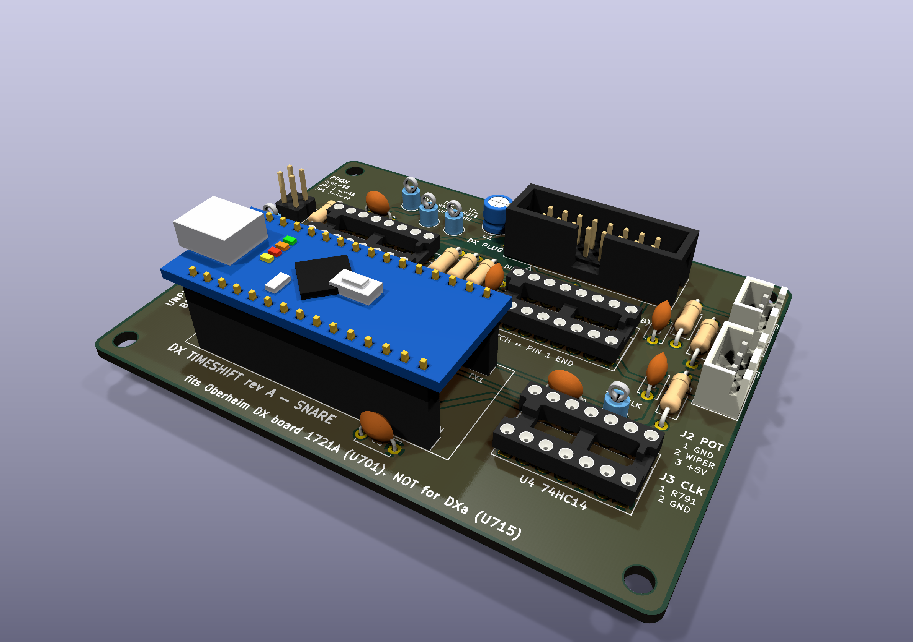
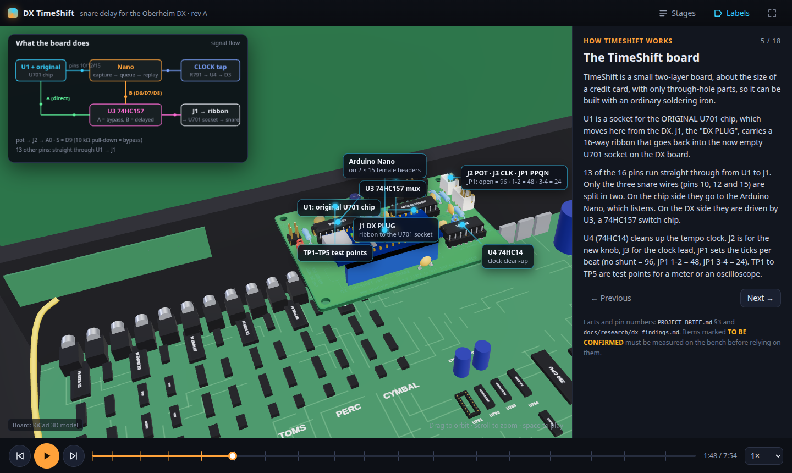

# DX TimeShift: a snare delay knob for the Oberheim DX

DX TimeShift adds one new knob to the rear panel of an Oberheim DX drum machine (1983), next to
the existing SNARE tuning pot. The knob makes the snare drum play later than the sequencer asks,
by anything from nothing at all up to one whole beat. This lets you "lay the snare back" behind the
groove. The delay is measured in beats, not milliseconds, so it stays musically the same when you
change the tempo. With the knob turned fully down the DX behaves exactly as it did from the factory.
The mod is a small plug-in circuit board. It sits in the socket of one chip on the DX main board
(U701), so it can be removed again. The only permanent change is one hole in the rear panel.

*The assembled DX TimeShift rev A board (3D render from the KiCad design). The 16-way box header
J1 DX PLUG is at the back right, the Arduino Nano at the front left, and the socket U1 for the
DX's own U701 chip is between them.*

> **Status: Design complete; NOT yet bench-verified on a real DX.**
>
> The circuit, the circuit board, the firmware and the drawings are finished and checked against
> each other. Nobody has yet fitted a TimeShift board to a real DX. Several facts about the DX were
> worked out from schematics, photos and the original firmware, and still need one measurement on
> the bench. The most important open questions are:
>
> 1. **Q0:** Is your unit a plain DX (main board 1721A)? The board does NOT fit a DXa (board 1906).
> 2. **Q1:** Is U701 in a socket? If it is soldered in, the mod is no longer fully reversible.
> 3. **Q2:** What do the snare trigger lines (RST2, FFA2, FFB2) really look like on a logic analyser?
> 4. **Q3:** Is there enough height under the closed lid for the board (about 32 mm)?
> 5. **Q4:** Does the U701 clock line (GEN0*) stay clean when it runs through the ribbon cable?
> 6. **Q5:** Does the CLOCK OUT tap at R791 behave as expected, and does it keep ticking when the sequencer is stopped?
> 7. **Q6:** Is there room behind the rear panel for the new pot?
> 8. **Q7:** Does the DX +5 V supply stay healthy with the board running?
> 9. **Ribbon mapping:** every one of the 16 conductors must pass a continuity check before first power-up.
>
> Each question, with the exact measurement that answers it, is in
> [docs/05-bench-verification.md](docs/05-bench-verification.md).

## Who this is for

* **The owner** of an Oberheim DX who wants a "laid back" snare. Read
  [docs/00-start-here.md](docs/00-start-here.md). It explains what the mod does, what it costs and
  how it will behave.
* **The electronics technician** who builds and fits it. You need to be comfortable with
  through-hole soldering, a multimeter, and working inside mains-powered vintage equipment. An
  oscilloscope or a logic analyser is needed for the verification steps. No surface-mount
  soldering is needed.
* **Anyone curious** about how a 1983 drum machine triggers its sounds. Read
  [docs/01-theory-of-operation.md](docs/01-theory-of-operation.md).

## If you are the technician, read in this order

| Step | Document | What you get from it |
|---|---|---|
| 1 | [docs/00-start-here.md](docs/00-start-here.md) | The big picture, the model check, the shopping list, the order of work |
| 2 | [docs/05-bench-verification.md](docs/05-bench-verification.md) | The open questions. Answer Q0, Q1, Q3 and Q6 before you order anything. |
| 3 | [docs/01-theory-of-operation.md](docs/01-theory-of-operation.md) | How the DX triggers the snare and how the TimeShift board delays it |
| 4 | [docs/bom.md](docs/bom.md) | Parts, part numbers, prices and tools |
| 5 | [docs/02-build-the-board.md](docs/02-build-the-board.md) | Ordering the PCB, soldering, making the ribbon cable, continuity check, flashing, bench test |
| 6 | [docs/03-install-in-the-dx.md](docs/03-install-in-the-dx.md) | Fitting the board, drilling the panel, the pot and clock wiring |
| 7 | [docs/04-test-and-calibrate.md](docs/04-test-and-calibrate.md) | First power-on, measurements, troubleshooting, how to remove the mod |
| Reference | [hardware/README.md](hardware/README.md) | The complete pin and net table. This is the reference for every pin number. |
| Reference | [firmware/README.md](firmware/README.md) | Flashing the Nano, settings, the serial status line |
| Reference | [hardware/mechanical/README.md](hardware/mechanical/README.md) | Drill template, wiring diagram, continuity sheet |

## Interactive 3D walkthrough

There is an interactive 3D walkthrough of the DX, the board, the build and the installation.
Once GitHub Pages is enabled for this repository it is at
**<https://sabrehagen.github.io/oberheim-dx-timeshift/>**. To run it on your own computer, see
[webapp/README.md](webapp/README.md).

*The web walkthrough. Each stage has a 3D view with labels on the real parts and a side panel
with the text. Items that are TO BE CONFIRMED are marked in amber.*

## Repository map

| Folder or file | What is in it |
|---|---|
| `README.md` | This page |
| `PROJECT_BRIEF.md` | The design brief: the single source of truth for the design decisions (sections 3 to 3.6) |
| `docs/` | The step-by-step guides (00 to 05), the bill of materials, the research findings and the collected reference documents |
| `hardware/` | The KiCad 9 design, Gerber files for ordering the PCB, schematic PDF, 3D renders and the mechanical drawings |
| `firmware/` | The Arduino Nano program, its settings file and PC tests |
| `webapp/` | The interactive 3D walkthrough (Vite and three.js) |
| `.github/` | The workflow that publishes the walkthrough to GitHub Pages |

## Safety notes

* **Mains voltage.** The DX has a mains transformer, fuse and line filter inside the case. Always
  switch off and **unplug the mains cable** before you open the lid or touch anything inside.
* **Stored energy.** The DX power supply has a 10 000 µF capacitor (C723). Wait at least a minute
  after unplugging before you work inside.
* **Static.** U701 is a 1983 CMOS chip (Motorola MC14174B). Wear an anti-static wrist strap
  connected to the DX chassis while you handle it. It cannot be bought new in the same form.
* **The memory battery.** The DX keeps your patterns in battery-backed memory. Never connect
  anything to the battery-backed "+5M" rail. Do not remove the battery or the memory chips. Save
  your patterns to cassette before you start, as the warning printed on the DX board advises.
* **USB.** The Nano's 5 V pin is connected to the DX logic supply. **Unplug the Nano before you
  connect USB**, or connect USB only while the DX is switched ON. Never plug USB into the Nano
  while it sits in an installed board in a switched-off DX.
* **Do not force anything.** Old sockets and chip legs bend easily. If a part does not go in,
  stop and look.

## Licence and credits

* The project's own original work is licensed as set out in [LICENSE.md](LICENSE.md): the
  hardware design under **CERN-OHL-P v2**, and the firmware, web app and documentation under
  **MIT**. The owner may change this later.
* The documents, schematics, manuals and photos in `docs/reference/` belong to their owners
  (Oberheim Electronics or its successors, Electrongate, the E&MM publisher, and the Wikimedia
  Commons photographers under their stated licences). They are kept here for repair and
  modification research only. See [docs/reference/INDEX.md](docs/reference/INDEX.md) for each
  source and its copyright notice.
* The research behind every pin number and timing value is in
  [docs/research/dx-findings.md](docs/research/dx-findings.md), with citations.
