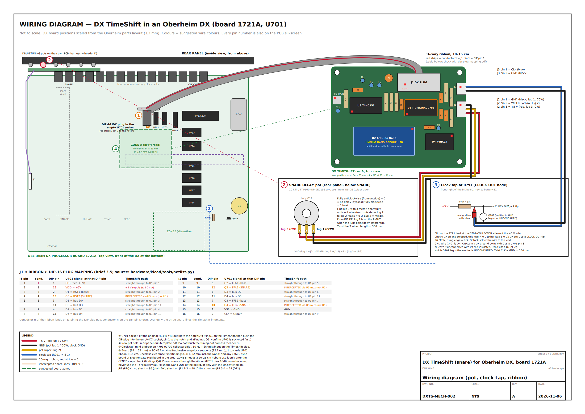

# 00. Start here

**Where you are in the process:** this is the first document. It gives the overview and the
order of work. Every other guide links back here.

This page is for the **owner** of the DX and for the **technician**. Read it all before you
order parts or open the DX.

## 1. What is being built

*Wiring diagram (drawing DXTS-MECH-002, not to scale). Left: the DX main board seen from above,
front of the DX at the bottom. Right: the TimeShift board. The grey ribbon joins the empty U701
socket (1) to J1 DX PLUG. The new pot (2) on the rear panel goes to J2 POT. The clock lead (3)
from R791 goes to J3 CLK. The green dashed box (4) is the suggested place for the board. The full
PDF is [hardware/mechanical/wiring-diagram.pdf](../hardware/mechanical/wiring-diagram.pdf).*

The Oberheim DX starts each snare sound by setting three logic wires that come from one chip,
**U701**. The TimeShift board is a small circuit board that takes U701's place in the circuit.
U701 is lifted out of its socket on the DX main board and pushed into socket **U1** on the
TimeShift board. A short ribbon cable runs from **J1 DX PLUG** on the TimeShift board to a
**DIP plug** that goes into the now-empty U701 socket. Thirteen of the sixteen wires pass straight
through, so the rest of the DX does not notice any change. The three snare wires go through the
TimeShift board instead. An Arduino Nano on the board records each snare hit and plays it back
later. A new **SNARE DELAY** pot on the rear panel sets how much later, from 0 to 1 beat. A thin
lead clipped to the DX's clock circuit tells the Nano the tempo.

## 2. Why it is a plug-in board (and why that matters)

* **Reversible.** Nothing on the original Oberheim circuit boards is cut or soldered. To undo the
  mod you unplug the ribbon, put U701 back in its socket and unclip the clock lead. The only
  permanent change is one 7.5 mm hole in the rear panel for the pot.
* **Fail-safe.** A switch chip on the board (a 74HC157 "multiplexer") connects the DX's own snare
  wires straight through whenever the knob is at zero. A resistor holds it in that position when
  the Nano is missing, not programmed, starting up or crashed. In all those cases the DX behaves
  as stock.
* **The bass is untouched.** U701 also drives the bass drum. Its bass outputs pass straight through.

This depends on U701 being in a socket. Photos of two DX units suggest it is. This is **TO BE
CONFIRMED** on your unit (question Q1). If U701 is soldered to the board, the only option is to
desolder it and fit a socket. That is a permanent (but restorable) change, and the owner must
agree to it first.

## 3. First check your model

> **STOP AND CHECK**
> The TimeShift rev A board fits **only the plain DX with main board 1721A**. It does **not** fit
> the DXa. Do this check before you buy anything.

| | Plain DX (fits) | DXa (does NOT fit rev A) |
|---|---|---|
| Years | 1983 | 1984 to 1985 |
| Rear panel | No MIDI jacks | MIDI IN and OUT jacks on the rear |
| Front panel | Function buttons the same size as the drum pads | Smaller function buttons |
| Main board silkscreen | "OBERHEIM DX PROCESSOR BOARD", drawing **1721A** | "DX 'A' Processor Board", drawing **1906** |
| Snare trigger chip | **U701**, pins 15 (RST2), 12 (FFA2), 10 (FFB2) | **U715**, pins 7 (RST2), 5 (FFA2), 2 (FFB2) |

Some plain DX units were upgraded later. An **Electrongate MIDI upgrade** puts MIDI jacks in the
right-hand end panel. An Oberheim **Stretch** expander adds a 4-voice panel on the left. Both of
these keep the 1721A board, so the TimeShift should still fit. Neither product is known to touch
U701, but you must check by eye that U701 is still on the main board.

> **Owner's answer (2026-11-06): this unit is a plain Oberheim DX.** The rev A board is the right
> one. Do the check below anyway when the lid is open: it records the board number, the firmware
> version and whether U701 is socketed, which the later steps need.

**How to check (about 15 minutes):**

1. Switch off and unplug the DX. Remove the two screws on the front and open the lid. (Full
   safety notes and steps: [03-install-in-the-dx.md](03-install-in-the-dx.md), sections 1 and 2.)
2. Read the title printed on the main board, bottom centre: it should say "OBERHEIM DX PROCESSOR
   BOARD".
3. Find U701. It is the first of a row of three 16-pin chips (U701, U702, U703) just below the
   two 470 µF capacitors C701 and C702, near the middle of the board. It should be marked
   MC14174B (or CD40174 or 74C174).
4. Look at the sides of U701 with a torch. A socket shows a black plastic frame under the chip.
5. Read the labels on the two operating-system chips U713 and U714 (for example "DX 1.4 A" and
   "DX 1.4 B"). Write the version down. It matters for question Q2.
6. Take clear photos of the whole board and of U701 close up. Note which end of U701 has the notch.

If the board says 1906, or U701 is not a 16-pin MC14174B-type chip, **stop**. See
[05-bench-verification.md](05-bench-verification.md), Q0.

## 4. What to buy

The full list is in [bom.md](bom.md) (and [bom.csv](bom.csv) for uploading to Digi-Key or Mouser).

| Section | What | Estimate (USD, Nov 2026) |
|---|---|---|
| A | TimeShift board parts, including a genuine Arduino Nano and the bare PCB | $50.63 |
| B | The DX plug cable (ribbon, IDC socket, DIP-16 IDC plug) | $5.10 |
| C | Panel pot, connectors, wire, heat-shrink, clips, cable ties, label tape | $56.37 |
| **Total** | **Sections A to C** | **$112.10** |

* With a Nano clone and wire and heat-shrink you already have, the cost drops to about $40 to $50.
* Shipping, tax and tools are not included.
* You do **not** buy a chip for U1. U1 holds the DX's own U701 chip.
* Most PCB makers have a minimum order of 5 boards (about $10 plus shipping).
* **Lead time** was not researched for this project. Typical figures are a few days for parts from
  a distributor and about 1 to 3 weeks for bare PCBs including shipping. Check when you order.

## 5. Tools you will need

| Tool | Used for |
|---|---|
| Temperature-controlled soldering iron, fine solder, flux | Building the board, pot lugs |
| Desoldering braid or pump | Fixing mistakes |
| Digital multimeter with continuity beep | The mandatory cable check, supply checks, finding the pot lugs |
| Logic analyser (4 MHz or faster, 4 or more channels) **or** an oscilloscope (20 MHz or faster) | The bench verification steps (Q2, Q4, Q5) and testing |
| DIP-16 test clip (Pomona 3916A) | Probing U701 in place for Q2 |
| Digital calipers (0.1 mm) | Rear-panel measurements, panel thickness |
| Centre punch, 3 mm drill, 7.5 mm drill or a step drill, deburring tool | The pot hole |
| Masking tape, paper, a vacuum cleaner | Keeping metal swarf off the DX board |
| 10 mm socket or spanner | The pot nut |
| IC extractor or a small flat screwdriver | Lifting U701 |
| Bench vice or IDC press | Crimping the ribbon connectors |
| JST XH crimp tool (or buy pre-crimped leads) | The pot and clock leads |
| Wire strippers, flush cutters, pliers, heat gun | Leads and heat-shrink |
| Phillips screwdriver | The DX lid screws |
| Modelling clay | Measuring the free height under the lid |
| Anti-static wrist strap | Handling U701 |
| USB-A to Mini-B cable and a computer with the Arduino IDE | Programming the Nano |

## 6. How long it takes

These are **rough estimates** for a technician who has done similar work. They are not measured.

| Phase | Time |
|---|---|
| Open the DX, check the model, socket, lid height and rear panel (Q0, Q1, Q3, Q6) | 1 to 2 hours |
| Logic-analyser checks on the stock DX (Q2, Q5), recommended before building | 1 to 2 hours |
| Waiting for parts and PCBs | see "Lead time" above |
| Solder the board | 1.5 to 3 hours |
| Make the ribbon cable and do the continuity check | 0.5 to 1 hour |
| Program the Nano and bench-test the board | about 1 hour |
| Install in the DX, including drilling the panel | 2 to 4 hours |
| Test and calibrate | 1 to 2 hours |

## 7. The order of work

Tick each step when it is done.

1. [ ] Read this page, then [01-theory-of-operation.md](01-theory-of-operation.md) if you want to
       understand the circuit.
2. [ ] Open the DX and check the model (section 3 above, and Q0 in
       [05-bench-verification.md](05-bench-verification.md)). Stop if it is a DXa.
3. [ ] Confirm U701 is socketed (Q1). If it is not, get the owner's agreement before going on.
4. [ ] Measure the free height under the lid at U701 and at the planned board position (Q3).
5. [ ] Measure the rear panel and the space behind it (Q6, and the checklist in
       [hardware/mechanical/README.md](../hardware/mechanical/README.md)).
6. [ ] Recommended: record the stock snare trigger lines and the clock with a logic analyser (Q2, Q5).
7. [ ] Order the PCB and the parts ([02-build-the-board.md](02-build-the-board.md) section 1 and [bom.md](bom.md)).
8. [ ] Solder the board ([02-build-the-board.md](02-build-the-board.md) sections 2 to 4).
9. [ ] Make the ribbon cable and pass the **mandatory continuity check** ([02-build-the-board.md](02-build-the-board.md) sections 5 and 6).
10. [ ] Program the Nano out of the board ([02-build-the-board.md](02-build-the-board.md) section 7 and [firmware/README.md](../firmware/README.md)).
11. [ ] Bench-test the board on its own, powered by USB ([02-build-the-board.md](02-build-the-board.md) section 8).
12. [ ] Install it in the DX ([03-install-in-the-dx.md](03-install-in-the-dx.md)).
13. [ ] First power-on, tests and calibration ([04-test-and-calibrate.md](04-test-and-calibrate.md)).
14. [ ] Fill in the results form in [05-bench-verification.md](05-bench-verification.md) and give
        a copy to the owner.

## 8. How it will behave when finished

**The SNARE DELAY knob**

* It sits directly below the SNARE tuning pot on the rear panel (exact position TO BE CONFIRMED,
  Q6). Like the DX tuning pots it has a short bare shaft. A small knob is an option.
* **Fully anticlockwise (0):** the DX is stock. The snare plays exactly when the sequencer says.
  The Nano only counts hits. Anything at or below 1 % of the knob's travel counts as zero.
* **Turning clockwise:** the snare plays later. The delay is a fraction of one beat.
* **Fully clockwise:** the snare plays one whole beat late.
* **Examples:** at 120 BPM one beat is 500 ms, so half way gives about 250 ms. At 90 BPM one beat
  is 667 ms, so half way gives about 333 ms.
* Turning the knob or changing the tempo while a snare is waiting takes effect at once.
* Loudness (soft, medium, loud) is kept for every delayed snare.
* Only the snare is affected. Every other drum is untouched.

**The LED** (the Nano's own "L" LED, on the board inside the DX, so you only see it with the lid open)

| LED | Meaning |
|---|---|
| Steady on | BYPASS: knob at zero, the DX is stock. It is also on from power-up until the first knob reading. |
| Off, with a short flash for each snare | DELAY: each flash is one snare hit being recorded |
| Never on | No power to the board, or the Nano is not running. See [04-test-and-calibrate.md](04-test-and-calibrate.md). |

**When there is no clock**

* The Nano gets the tempo from the DX's clock output. The DX sends 96 clock ticks per beat.
* If the Nano has never seen a clock tick since power-up (for example you only play the pads with
  the sequencer stopped), it assumes **120 BPM**.
* If the clock stops for more than 2 seconds, it keeps using the **last tempo it measured**.
* Whether the DX keeps sending clock ticks while the sequencer is stopped is TO BE CONFIRMED (Q5).

**Things you may notice**

* Snares that were already waiting when you press STOP still play after the stop.
* When you turn the knob down quickly, waiting snares can come out a little early. When the knob
  reaches zero, any snare still waiting is dropped.
* At a delay of a full beat, a delayed snare can land on top of the next snare. The newer hit cuts
  the older one off, just as two close hits do on a stock DX.
* For one to two seconds after power-on the Nano is starting up. The board is in BYPASS during that
  time, so the DX is stock.
