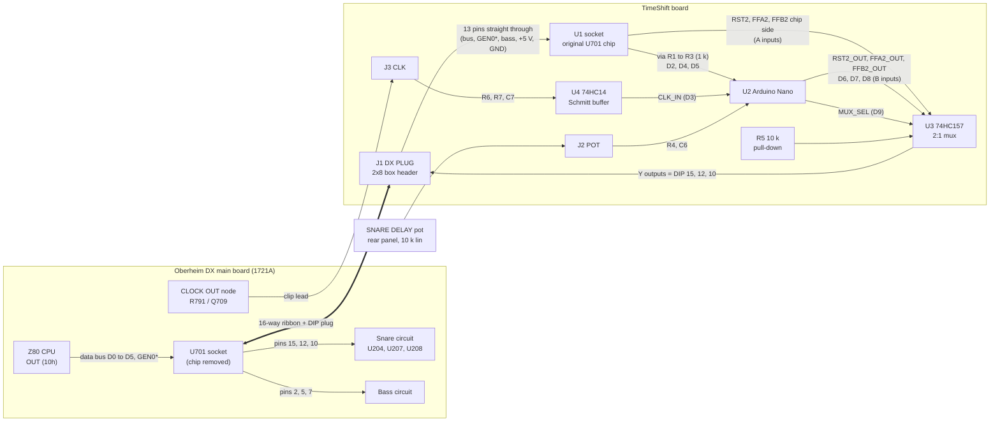
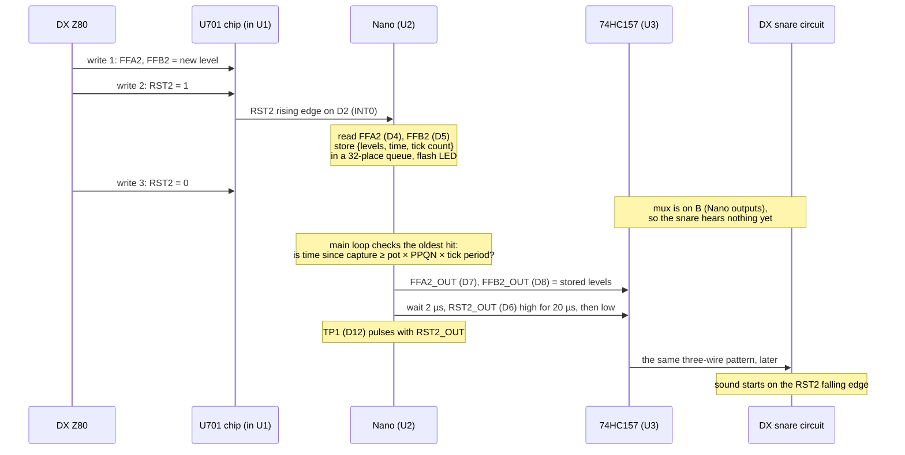

# 01. Theory of operation

**Where you are in the process:** background reading. You do not need it to follow the build
steps, but it explains why each step matters. Back to [00-start-here.md](00-start-here.md).

Every fact about the DX in this document comes from
[research/dx-findings.md](research/dx-findings.md). Each one carries the same tag as there:

* **VERIFIED**: read from a primary source (schematic, layout, manual, photo, or the original firmware).
* **INFERRED**: worked out from verified facts. Probably right, but not proven.
* **TBC** (TO BE CONFIRMED): must be measured on the bench. See [05-bench-verification.md](05-bench-verification.md).

Pin numbers on the TimeShift board come from [hardware/README.md](../hardware/README.md)
section 6, which is the master table.

## 1. The idea in one paragraph

The DX's processor starts a snare sound by setting three logic wires. The TimeShift board cuts
those three wires, records each pattern that appears on them together with the time it appeared,
and plays the same pattern back onto the wires later. "Later" is a fraction of one beat set by the
SNARE DELAY pot. The board knows how long a beat is because it counts the DX's own tempo clock.
When the pot is at zero, a hardware switch joins the three wires straight through again.

## 2. How the DX triggers the snare

### 2.1 One board, no voice cards (VERIFIED)

The DX has a single main circuit board, the "DX Processor Board", drawing 1721A. It carries the
Z80 processor and all six drum voices. There are no plug-in voice cards. (Findings section 0 and a.)

### 2.2 U701, the trigger latch (VERIFIED, DX schematic sheet 1)

U701 is a Motorola **MC14174B**: six "D flip-flops" in one 16-pin package. It works like six
one-bit memories that all store their inputs at the same moment. That moment is the rising edge
of its clock pin (pin 9). U701 then **holds** its six outputs until the next time it is clocked.

The Z80 writes to U701 with the instruction `OUT (10h),A`. The address decoder U709 turns that
write into a short low pulse called **GEN0*** on U701 pin 9. The bits of the byte land like this:

| Data bit | U701 input pin | U701 output pin | Signal | Voice |
|---|---|---|---|---|
| D0 | 3 | 2 | RST1 | Bass |
| D1 | 4 | 5 | FFA1 | Bass |
| D2 | 6 | 7 | FFB1 | Bass |
| D3 | 14 | **15** | **RST2** | **Snare** |
| D4 | 13 | **12** | **FFA2** | **Snare** |
| D5 | 11 | **10** | **FFB2** | **Snare** |

U701 pin 16 is +5 V, pin 8 is ground, and pin 1 (clear) is tied to +5 V so the chip is never
cleared. The snare uses no other wires from the processor.

### 2.3 What the three snare wires do (VERIFIED, DX schematic sheet 4)

* **RST2** ("reset 2") is the start signal.
  * While RST2 is **high**, the snare's sample address counter (U207, a CD4040) is held at zero.
    RST2 high also clears the end-of-sample flip-flop in U208, which re-enables the sample EPROM.
  * The **rising** edge of RST2 clocks the two level flip-flops in U204.
  * When RST2 goes **low**, the counter is released and the snare sample starts to play.
* **FFA2** and **FFB2** set the loudness (soft, medium or loud). They reach the asynchronous reset
  pins of the U204 flip-flops. Those flip-flops switch resistors and diodes into the reference of
  the sample DAC (U205). FFA also selects which half of the sample EPROM is used, through jumper SJ2.
* Because FFA2 and FFB2 act as resets for as long as they are high, they behave as **held
  levels**, not just as values sampled at one moment. They must stay valid for the whole sound.
* A new RST2 pulse simply restarts the counter. So a new snare **cuts off** the previous one.

The exact code for soft, medium and loud is **INFERRED** from the circuit and is TBC (Q2):

| Pad | FFA2 | FFB2 |
|---|---|---|
| LOUD | 1 | 1 |
| MEDIUM | 0 | 1 |
| SOFT | x (either) | 0 |

### 2.4 The three writes (VERIFIED by firmware disassembly; timing TBC)

The original firmware performs **three writes** to U701 for every snare hit:

1. Write 1: FFA2 and FFB2 take their new level. RST2 stays low.
2. Write 2: RST2 goes high. The U204 flip-flops are clocked and the counter is reset.
3. Write 3: RST2 goes low. The counter is released. **The sound starts here.**

How long RST2 stays high depends on the firmware version:

| Firmware | RST2 high time | Tag |
|---|---|---|
| 1.5 | about **9 µs** (22 Z80 clock cycles at about 2.46 MHz) | VERIFIED by firmware analysis, but it is a calculation. TBC with a logic analyser (Q2). |
| 1.20 | about **0.2 ms** (about 550 clock cycles, counted by hand) | VERIFIED by firmware analysis, approximate. TBC (Q2). |
| 1.4, 3.01 (Electrongate), DXa 2.02 | not analysed | TBC (Q8) |

Other facts from the same analysis:

* Interrupts are switched off during the three writes.
* Writes for other voices (for example the bass, which shares U701) rewrite the snare bits with
  their **unchanged** values. They should cause **no** edges on RST2, FFA2 or FFB2. VERIFIED by
  reading the firmware, TBC on the bench (Q2).
* At power-up the firmware writes 09h, which holds RST1 and RST2 high.
* GEN0* is a low pulse of about 1 µs. INFERRED from the Z80 bus timing. TBC.

### 2.5 Timing diagram of one snare hit

This is Appendix A of the findings, redrawn. It shows firmware 1.5 timing. Time runs left to right
and is not to scale.

```
                  write 1        write 2        write 3
GEN0*  (U701-9)  ‾‾‾‾\_/‾‾‾‾‾‾‾‾‾‾\_/‾‾‾‾‾‾‾‾‾‾‾\_/‾‾‾‾‾‾‾‾‾‾‾‾‾‾‾‾‾‾‾‾‾‾‾‾‾‾‾‾
                      ↑ U701 stores on each rising edge

FFA2/FFB2        =====X== new level ==================================(held)====
(U701-12, -10)

RST2   (U701-15) ___________________/‾‾‾‾‾‾‾‾‾‾‾‾‾‾\_________________________
                                    |<- ≈ 9 µs  ->|   (FW 1.5)
                                    |<- ≈ 0.2 ms  ->| (FW 1.20)

U204 level FFs                      ↑ clocked here (rising edge of RST2)

CD4040 counter   ..running/stopped..|   held at 0  |>> counting: SNARE SOUND STARTS
                                                    ↑ falling edge of RST2
```

The TimeShift board reproduces exactly this pattern on U701 pins 15, 12 and 10, only later. Its
own RST2 high time is 20 µs.

### 2.6 What this means for the design

Delaying only RST2 would not be enough. The loudness lines FFA2 and FFB2 must arrive with the
delayed RST2 and stay held until the next delayed hit. Otherwise a delayed snare could play at the
loudness of the next, not-yet-delayed hit. So the TimeShift board records and replays **all three
wires together**.

U701 itself already holds the three levels between writes, so it acts as the "capture latch". No
extra latch chip is needed.

## 3. Why "one beat" needs the clock

A beat is a musical length, not a fixed time. One beat is 500 ms at 120 BPM but 667 ms at 90 BPM.
A simple analogue delay (a resistor and capacitor timer) gives a fixed number of milliseconds. It
would be "one beat" at only one tempo. To make the pot mean "0 to 1 beat" at every tempo, the
board must know the tempo.

The DX sends a clock tick **96 times per beat** (96 PPQN). This is VERIFIED from three sources:
the 1983 E&MM review, the owner's manual (parameter 03, "96 pulses per quarter note") and the
firmware. The DX tempo range is 25 to 250 BPM.

| Tempo | One beat | One tick (1/96 beat) |
|---|---|---|
| 25 BPM | 2400 ms | 25.0 ms |
| 60 BPM | 1000 ms | 10.4 ms |
| 90 BPM | 667 ms | 6.94 ms |
| 120 BPM | 500 ms | 5.21 ms |
| 250 BPM | 240 ms | 2.50 ms |

The Nano measures the time between ticks (averaged over the last 4 ticks) and works out:

```
delay (µs) = pot position (0 to 1) × PPQN × measured tick period (µs)
```

The calculation is continuous, so the pot does not move in 1/96-beat steps. The delay follows a
tempo change at once, even for a snare that is already waiting.

**Clock rate variants.** On a DXa, a Stretch DX or a DX with the Electrongate MIDI upgrade, the
clock output can be set to 24, 48 or 96 PPQN (edit parameter 03). When slaved to MIDI it is
forced to 24. The board has a jumper, **JP1 PPQN**, to match (see section 8.3).

## 4. Block diagram of the TimeShift board



*Block diagram. Thick arrow: the ribbon. The three snare lines are split: the chip side goes only
to the mux A inputs and the Nano; the DX side is driven only by the mux outputs.*

The full schematic is [hardware/exports/schematic.pdf](../hardware/exports/schematic.pdf). Its
blocks are: A, the DX socket interface (J1 and U1); B, the bypass and delay multiplexer (U3);
C, the PPQN jumper, mux pull-down and test points; D, the Arduino Nano (U2) and the protection
resistors; E, the clock input (J3, U4); F, the pot, power, decoupling and mounting holes.

## 5. Capture, queue and replay

### 5.1 The flow of one hit (DELAY mode)



### 5.2 Capture

* RST2 from U701 (U1 pin 15) goes through R1 (1 kΩ) to Nano pin **D2**, which is external
  interrupt **INT0**, set to trigger on a **rising** edge.
* The AVR chip on the Nano stores the edge in a hardware flag. So even a 9 µs pulse cannot be
  missed if the program is busy for a moment.
* In the interrupt routine the Nano reads FFA2 (U1 pin 12 → R2 → D4) and FFB2 (U1 pin 10 → R3 → D5).
  They were set by write 1 and stay stable until the next hit, which is at least about 1 ms later.
* It stores the two levels, the time in microseconds, and the tick count in a ring buffer
  ("queue") with 32 places.
* Hits are counted in BYPASS mode too, but are not replayed.

### 5.3 Queue

* Several hits can wait at once. They are replayed in the order they arrived.
* If 32 hits are already waiting, a new hit is dropped and counted as `dropped`.
* A hit that has waited more than 4 seconds is dropped. At 25 BPM one beat is 2.4 s, so a normal
  hit never waits that long.
* When the pot returns to zero (BYPASS), waiting hits are dropped.

### 5.4 Replay

* The main loop checks the oldest waiting hit again and again. A hit is due when
  `time since capture ≥ pot position × PPQN × tick period`.
* The replay copies the DX's own sequence: set FFA2_OUT and FFB2_OUT to the stored levels, wait
  2 µs, raise RST2_OUT for 20 µs, lower it. TP1 (D12) goes high at the same moment as RST2_OUT.
* The levels stay held until the next replay, exactly as U701 holds them in a stock DX.
* The DX's own RST2 high time is 9 µs to 0.2 ms; the replay uses 20 µs. The delay is counted from
  the rising edge, and the sound starts on the falling edge. So the replayed sound can start up to
  about 0.2 ms earlier or later than "exactly D after the original". That is far below what anyone
  can hear. The pulse length is a setting (`RST2_PULSE_US`, 10 to 200 µs) in
  `firmware/timeshift/timeshift_config.h`.

The serial output never delays a replay: the status text is only built when no hit is due in the
next 5 ms. (firmware/README.md section 7.)

## 6. The bypass multiplexer, and why it is safe

U3 is a **74HC157**, a quad 2-to-1 multiplexer. Each of its four channels is a switch with two
inputs, A and B, and one output, Y. One select pin, S (pin 1), sets all four switches at once.

| S (U3 pin 1) = MUX_SEL (Nano D9) | Y outputs follow | Mode |
|---|---|---|
| LOW | A inputs = U701's own outputs | **BYPASS**: the DX is stock |
| HIGH | B inputs = the Nano's outputs | **DELAY** |

| Channel | A input (chip side) | B input (Nano) | Y output (to the DX, via J1) |
|---|---|---|---|
| 1 | U3 pin 2 = RST2_CHIP (U1 pin 15) | U3 pin 3 = RST2_OUT (D6) | U3 pin 4 = RST2_PLUG → DIP 15 |
| 2 | U3 pin 5 = FFA2_CHIP (U1 pin 12) | U3 pin 6 = FFA2_OUT (D7) | U3 pin 7 = FFA2_PLUG → DIP 12 |
| 3 | U3 pin 11 = FFB2_CHIP (U1 pin 10) | U3 pin 10 = FFB2_OUT (D8) | U3 pin 9 = FFB2_PLUG → DIP 10 |
| 4 (unused) | U3 pin 14 = GND | U3 pin 13 = GND | U3 pin 12, not connected |

U3 pin 15 (enable) is tied to ground, so the chip is always enabled.

**Why it is safe:**

* **R5 (10 kΩ)** pulls S low, so the default is BYPASS. The Nano must actively drive D9 high to
  select DELAY.
* While the Nano is in reset, starting up, unprogrammed, crashed or missing, its pins do not drive
  S high. R5 holds S low, and the DX is stock.
* In BYPASS the only thing between U701 and the snare circuit is one 74HC157 gate. The brief
  estimates about 10 ns of added delay. No firmware is in the path.
* The 74HC157 and U701 are both powered from the DX +5 V through the plug, so the bypass works
  whenever the DX is on.
* **Glitch-free switching.** Before going into DELAY, the Nano copies the current chip-side FFA2
  and FFB2 levels to its own outputs and sets RST2_OUT low. Only then does it raise S. So nothing
  changes on the snare lines at the moment of switching. It never changes S while RST2 is high
  on either side. Going back to BYPASS, it waits until no replay is in progress.
* **Isolation.** U1 pins 10, 12 and 15 connect **only** to the mux A inputs and (through 1 kΩ)
  to the Nano. J1 DIP pins 10, 12 and 15 are driven **only** by the mux Y outputs. There is no
  direct path, so a snare can never be played twice.
* The **1 kΩ resistors R1 to R3** limit the current between U701's outputs and the Nano's pins if
  a Nano pin is ever wrongly set as an output.

## 7. Clock conditioning

### 7.1 The DX side (VERIFIED, DX schematic sheet 1)

The CLOCK OUT jack is driven by transistor **Q709**. Its collector goes to the jack tip and is
pulled up to +5 V by **R791 (1 kΩ)**. Its base is driven through R792 (4.7 kΩ) from the signal
COUT (U710 pin 2). The firmware analysis (VERIFIED by disassembly, real behaviour TBC) says:

* At the jack tip (the Q709 collector, and the R791 lead on that side) the signal **idles low**.
* Each tick is a **positive pulse**. The **rising edge** is the timing reference.
* The pulse is high for roughly 0.85 ms (idle ticks) to a few ms (ticks when the sequencer is
  working).
* At COUT (the U710 side of R792) the polarity is the opposite.
* Whether ticks continue while the sequencer is stopped is TBC (Q5).

The TimeShift board taps the **R791 lead on the Q709-collector side** with a clip. The rear jacks
are soldered to the main board, so tapping the jack itself would mean soldering under the board.

### 7.2 The TimeShift side

```
J3 pin 1 ──R6 10 kΩ──┬──────────┬──► U4 pin 1 ─[74HC14]─ pin 2 ──► pin 3 ─[74HC14]─ pin 4 ──► CLK_IN (Nano D3, TP5)
(from R791)          │          │
                  R7 100 kΩ   C7 1 nF
                     │          │
J3 pin 2 ── GND ─────┴──────────┴── GND
```

* **R6 (10 kΩ)** in series means the tap draws very little current from the DX. Calculated: with
  the clock high, about 5 V / (1 kΩ + 10 kΩ + 100 kΩ) ≈ 45 µA.
* **R7 (100 kΩ)** pulls the input low if the lead is unplugged, so the input never floats.
* **C7 (1 nF)** with R6 forms a filter with a time constant of about 10 µs (calculated). It removes
  fast spikes picked up by the lead but passes a tick pulse of about a millisecond.
* With the clock high, R6 and R7 divide the voltage to about 4.5 V (calculated). That is well
  above the Schmitt input's switching level.
* **U4 (74HC14)** has Schmitt-trigger inputs. They give a clean, fast edge even from a slow or
  noisy input. Two inverters in series cancel each other's inversion, so a **rising edge at R791 is
  a rising edge at D3**.
* D3 is interrupt INT1, set to trigger on rising edges. Every tick increments a counter and updates
  the 4-tick average period. Ticks closer than 1 ms apart are ignored as noise.
* The four unused 74HC14 inputs (pins 5, 9, 11, 13) are tied to ground, as CMOS inputs must not float.

Only the time **between** ticks is used to set the delay. So even if the tick polarity turned out
to be reversed (Q5), the measured tempo and the delay would still be correct.

## 8. The pot and the settings

### 8.1 The pot

* The rear-panel pot is a **10 kΩ linear** pot (TT Electronics/BI P160KNP-0EC15B10K).
* Its anticlockwise lug (lug 1) goes to J2 pin 1 (GND). Its wiper (lug 2) goes to J2 pin 2. Its
  clockwise lug (lug 3) goes to J2 pin 3 (+5 V). So the wiper voltage rises from 0 V to 5 V as you
  turn clockwise.
* The wiper passes through **R4 (1 kΩ)** with **C6 (100 nF)** to ground. This filter (time constant
  0.1 ms, calculated) removes noise picked up by the lead. Then it reaches Nano pin **A0**.

### 8.2 Pot scaling in the firmware

* A0 is read 100 times per second. The Nano's converter gives a number from 0 to 1023.
* The last 16 readings are averaged.
* A dead band of 4 counts ("hysteresis") stops small noise from moving the delay.
* **At or below 1 %** (10 counts or less): BYPASS. MUX_SEL is low.
* **Above 1 %**: DELAY. pot position = reading / 1023, and delay in beats = pot position × 1.0
  (`MAX_DELAY_BEATS`). Full clockwise gives exactly 1.00 beat.
* A pot exactly at half turn reads 512, which is 50.05 %. At 120 BPM that gives about 250.2 ms.

### 8.3 PPQN jumper JP1

JP1 is a 2×2 pin header with two jumper positions, **JP1 1-2** and **JP1 3-4**, as printed on the
silkscreen ("open=96, 1-2=48, 3-4=24"). Pins 2 and 4 are ground. Pin 1 goes to Nano D10 (net
PPQN_J1) and pin 3 to D11 (net PPQN_J2). Both have the Nano's internal pull-up switched on. The
firmware reads them once at power-up.

| JP1 1-2 (D10) | JP1 3-4 (D11) | PPQN | Use |
|---|---|---|---|
| open | open | **96** | Plain DX (default). Park the shunt on one pin only. |
| closed | open | 48 | DXa, Stretch or MIDI-upgraded DX with parameter 03 = 48 |
| open | closed | 24 | Parameter 03 = 24, or slaved to MIDI clock |
| closed | closed | 96 | Not valid. The firmware uses 96 and prints a warning. |

## 9. Power

* The TimeShift board takes **+5 V and ground only from the U701 socket**: DIP pin 16 (+5 V) and DIP
  pin 8 (ground), through the ribbon. There are no extra power wires.
* There are **no ±12 V** on the U701 socket, and the board does not need them.
* The design budget is **under 60 mA** in total (brief section 3.3). The DX +5 V supply is a linear
  regulator (µA723 with a 2N3055 pass transistor). Its current limit is INFERRED to be about 2.6 A,
  and the DX's own +5 V load is INFERRED to be about 1 A. So the board adds only a few percent.
  The real headroom is TBC (Q7).
* **C1 (10 µF electrolytic)** next to J1 is the bulk capacitor. **C2, C3, C4 and C5 (100 nF)** sit
  next to U1, U3, U4 and the Nano to keep each chip's supply clean.
* The board never uses the DX's battery-backed "+5M" memory rail.
* **The USB warning.** The Nano's 5 V pin is on the same +5 V net as the DX logic. If you connect
  USB to the Nano while the board is installed in a switched-off DX, the computer's USB port would
  try to power the whole DX logic board. So: program the Nano out of the board, or connect USB only
  while the DX is switched on. The board is printed "UNPLUG NANO BEFORE USB".

## 10. Glossary

| Word | Meaning |
|---|---|
| **Beat** | One count of the music, a quarter note. At 120 BPM there are 120 beats per minute, so one beat lasts 0.5 s. |
| **BPM** | Beats per minute: the tempo. |
| **PPQN** | Pulses per quarter note. The number of clock ticks the drum machine sends for every beat. The DX sends 96. |
| **Clock tick** | One pulse of the tempo clock. At 96 PPQN, one tick is 1/96 of a beat. |
| **Trigger** | The signal that tells a drum voice to start its sound. |
| **Logic level** | A wire that is either "high" (about 5 V, written 1) or "low" (about 0 V, written 0). |
| **Rising edge / falling edge** | The moment a signal goes from low to high (rising) or from high to low (falling). |
| **Pulse** | A signal that goes high for a short time and then low again (or the reverse). |
| **Latch, flip-flop** | A small memory that stores a logic level and holds it until it is told to store a new one. U701 has six. |
| **Strobe** | A short pulse that tells a latch "store your input now". GEN0* is the strobe for U701. |
| **Data bus** | The eight wires (D0 to D7) the processor uses to send a byte to other chips. |
| **Interrupt** | A hardware signal that makes a processor stop what it is doing and run a short routine at once. The Nano uses INT0 for snare hits and INT1 for clock ticks. |
| **Queue, ring buffer** | A list where items wait in order. The first one in is the first one out. The Nano's has 32 places. |
| **Mux (multiplexer)** | A switch chip that connects its output to one of two (or more) inputs, chosen by a select pin. U3 is one. |
| **Bypass** | The mode where the mux connects the DX's own snare lines straight through, so the DX is stock. |
| **Interposer** | A board that is plugged in between a chip and its socket so it can watch or change signals. TimeShift is one. |
| **Socket** | A holder soldered to a board so a chip can be plugged in and out without soldering. |
| **DIP, DIP-16** | Dual in-line package: a chip with two rows of legs. DIP-16 has 16 legs, 8 on each side, rows 7.62 mm (0.3 in) apart. |
| **Pin 1, notch** | Chips and sockets have a notch or dot at one end. Pin 1 is next to it. Pins are numbered anticlockwise when seen from the top. |
| **IDC** | Insulation-displacement connector. A connector that is pressed onto flat ribbon cable. Its blades cut through the insulation, so no stripping or soldering is needed. |
| **Ribbon cable** | Flat cable with many wires side by side. One edge is marked with a red stripe: that is wire 1. |
| **Box header** | A two-row pin header with a plastic shroud around it. A slot in the shroud makes the plug fit only one way. J1 is one. |
| **JST-XH** | A small, locking, 2.5 mm-pitch wire-to-board connector. J2 and J3 are this type. |
| **Pull-down resistor** | A resistor from a signal to ground. It holds the signal low when nothing else drives it. R5 and R7 are pull-downs. |
| **Pull-up resistor** | The same, but to +5 V, holding the signal high. |
| **Series resistor** | A resistor placed in line with a signal to limit current or to form a filter. R1 to R4 and R6 are series resistors. |
| **Schmitt trigger** | A logic input with two switching levels, one for rising and one for falling. It turns a slow or noisy signal into a clean edge. U4 has six. |
| **RC filter** | A resistor and a capacitor that smooth a signal by removing fast changes. |
| **Decoupling capacitor** | A small capacitor (here 100 nF) right next to a chip's power pins. It supplies quick bursts of current and keeps noise off the supply. |
| **Electrolytic capacitor** | A larger-value capacitor that has a + and a − lead. It must be fitted the right way round. C1 is one. |
| **Hysteresis** | A small dead band, so a reading has to change by more than a little before the result changes. |
| **Potentiometer (pot)** | A variable resistor with a knob or shaft. The middle lug (wiper) gives a voltage between the two outer lugs. |
| **Linear pot** | A pot whose output changes evenly with rotation. |
| **CMOS** | A type of logic chip that uses very little power but can be damaged by static electricity. |
| **ESD** | Electrostatic discharge: a static spark. It can kill CMOS chips without you feeling it. |
| **Continuity test** | Using a multimeter's beep setting to check that two points are connected (or not). |
| **Test point (TP)** | A small loop on the board where you can clip a probe. |
| **Logic analyser** | An instrument that records many logic signals at once and shows them as a timeline. |
| **Oscilloscope (scope)** | An instrument that draws a signal's voltage against time. |
| **Firmware** | The program stored in a chip, such as the Nano's program or the DX's own operating system. |
| **Z80** | The 8-bit processor inside the DX. |
| **EPROM** | A memory chip that holds a program or a sound sample. The DX's sounds are stored in EPROMs. |
| **+5M** | The DX's battery-backed supply for its pattern memory. Never connect anything to it. |
