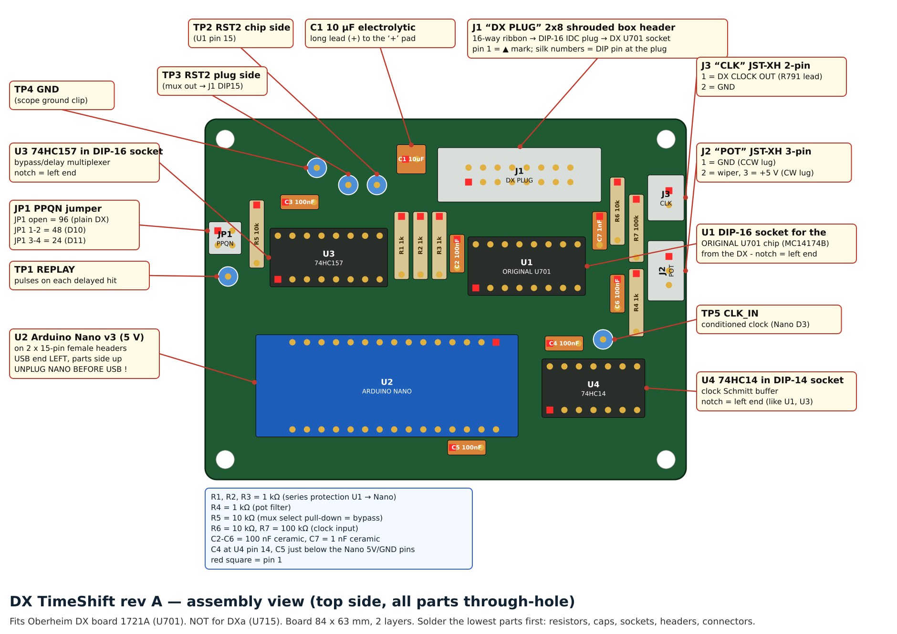
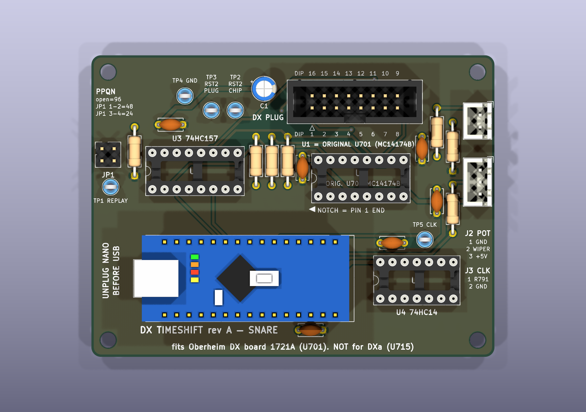
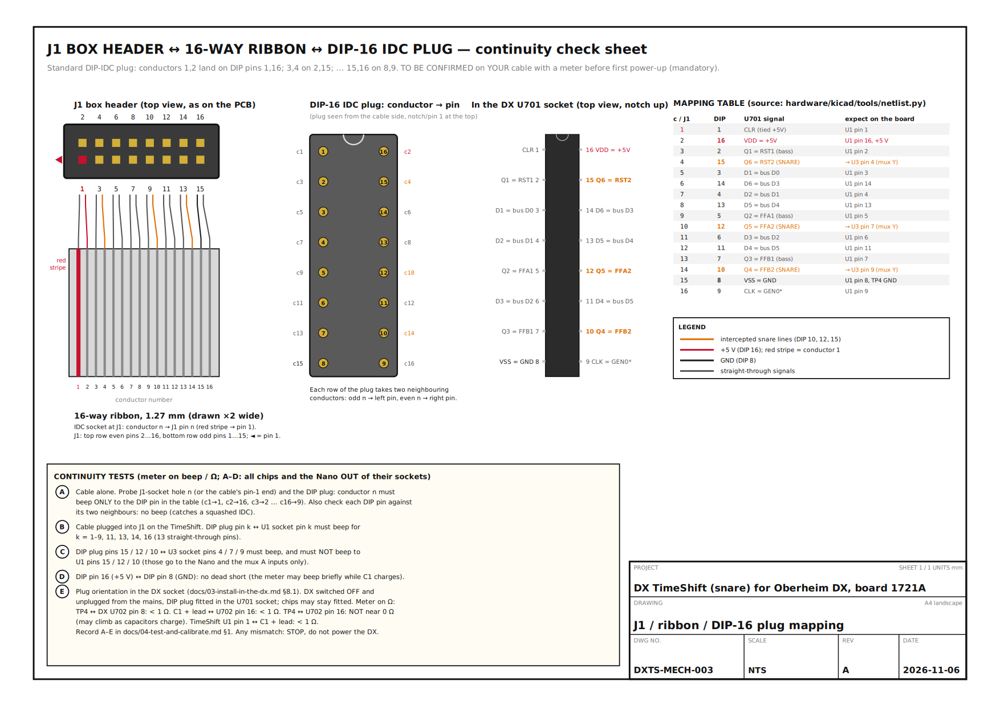

# 02. Build the board

**Where you are in the process:** steps 7 to 11 of the order of work in
[00-start-here.md](00-start-here.md). You have checked the model (plain DX, board 1721A) and you
know where the board will go in the DX. The DX is not involved in this document at all.

> **You will need**
>
> * The bare TimeShift rev A PCB and all parts from sections A and B of [bom.md](bom.md)
> * Soldering iron (temperature-controlled), 0.5 to 0.8 mm solder, flux, desoldering braid
> * Flush cutters, needle-nose pliers
> * Digital multimeter with a continuity beep
> * Bench vice or IDC press, and a small flat piece of wood or metal to protect the connectors
> * USB-A to Mini-B cable and a computer with the Arduino IDE 2
> * For the bench test: the SNARE DELAY pot with its lead (or any 10 kΩ pot), two short pieces of
>   solid wire (resistor leg offcuts are ideal), one 10 kΩ resistor with two crocodile or
>   mini-grabber leads, one female-to-male jumper wire, and an oscilloscope or logic analyser
>   (strongly recommended)
> * Optional: a signal generator (or a second Arduino) to fake the DX clock
> * Anti-static wrist strap

## 1. Order the PCB

1. Go to a PCB maker (JLCPCB, PCBWay or similar).
2. Upload **`hardware/gerbers/timeshift-revA-gerbers.zip`** exactly as it is. Do not unzip it.
3. Check the order settings. The makers' default settings work.

| Setting | Value |
|---|---|
| Layers | 2 |
| Board size | 84.0 × 63.0 mm (the maker usually reads this from the files) |
| Material and thickness | FR-4, 1.6 mm |
| Copper weight | 1 oz (35 µm) on both layers |
| Surface finish | HASL (lead-free) or ENIG. Either is fine because every part is through-hole. |
| Solder mask and silkscreen | Any colour (green with white text is fine) |
| Stencil, castellated holes, impedance control | None |

4. Most makers want a minimum of 5 boards. That is fine.
5. When the boards arrive, check that the silkscreen reads "DX TIMESHIFT rev A" and "fits Oberheim
   DX board 1721A (U701). NOT for DXa (U715)".

More detail on the files is in [hardware/gerbers/README.md](../hardware/gerbers/README.md).

## 2. Kit the parts

Lay the parts out on a sheet of paper and tick each one off. The reference designators (U1, R5 and
so on) are printed on the board and listed in [bom.csv](bom.csv).

| ✓ | Ref | Qty | Part | How to recognise it |
|---|---|---|---|---|
| ☐ | (PCB) | 1 | DX TimeShift rev A bare board | 84 × 63 mm, 4 corner holes |
| ☐ | U1 | 1 | DIP-16 IC socket | **Holds the DX's own U701 chip.** You do not buy a chip for U1. |
| ☐ | U2 | 1 | Arduino Nano v3 (ATmega328P, 5 V, 16 MHz) | Blue board with a Mini-B USB socket |
| ☐ | U2 sockets | 2 | Female header, 1 × 15, 2.54 mm | Black strips with 15 holes |
| ☐ | U3 | 1 | 74HC157 (DIP-16) + DIP-16 socket | Marked "HC157" |
| ☐ | U4 | 1 | 74HC14 (DIP-14) + DIP-14 socket | Marked "HC14" |
| ☐ | J1 | 1 | 2 × 8 shrouded box header | Black plastic box around 16 pins, with a slot in one long side |
| ☐ | J2 | 1 | JST-XH 3-pin header | White, 3 pins |
| ☐ | J3 | 1 | JST-XH 2-pin header | White, 2 pins |
| ☐ | JP1 | 1 | 2 × 2 pin header + 1 jumper shunt | 4 gold pins |
| ☐ | R1, R2, R3, R4 | 4 | 1 kΩ, 1 %, 1/4 W | Bands: brown, black, black, brown, brown |
| ☐ | R5, R6 | 2 | 10 kΩ, 1 %, 1/4 W | Bands: brown, black, black, red, brown |
| ☐ | R7 | 1 | 100 kΩ, 1 %, 1/4 W | Bands: brown, black, black, orange, brown |
| ☐ | C1 | 1 | 10 µF electrolytic, 5 mm diameter | Small can. A stripe marks the **negative** lead. The longer lead is **positive**. |
| ☐ | C2, C3, C4, C5, C6 | 5 | 100 nF ceramic | Small blob, usually marked "104" |
| ☐ | C7 | 1 | 1 nF ceramic (C0G) | Small blob, usually marked "102" |
| ☐ | TP1, TP2, TP3, TP5 | 4 | Test point loop, red (Keystone 5005) | |
| ☐ | TP4 | 1 | Test point loop, black (Keystone 5006) | This one is ground |
| ☐ | H1 to H4 | 4 | Self-adhesive snap-lock PCB supports, 12.7 mm | Used during installation |
| ☐ | Cable | 1 | 3M 89116-0101 IDC socket 2 × 8 + strain relief clip | Goes on J1 |
| ☐ | Cable | 1 | Adam Tech FDP-316-T DIP-16 IDC plug | Goes into the DX's U701 socket |
| ☐ | Cable | 1 | 16-way grey ribbon, 1.27 mm pitch | One edge has a red stripe |

Measure every resistor with the multimeter before you fit it. Colour bands are easy to misread.

## 3. Know the board



*Assembly view of the top side (from [hardware/renders/assembly-diagram.png](../hardware/renders/assembly-diagram.png)).
Every part has a callout. A red square marks pin 1 of every part.*



*3D render of the finished board, seen from above. Note the silkscreen: "NOTCH = PIN 1 END" under
U1, the DIP pin numbers printed around J1, the PPQN legend next to JP1, and "UNPLUG NANO BEFORE
USB" at the Nano's USB end.*

### 3.1 Orientation: get these right first time

> **STOP AND CHECK**
> These parts only work one way round. Check each one against the silkscreen **before** you solder
> it. Desoldering a 16-pin socket from a 2-layer board with ground pours is slow and can damage it.

| Part | Rule | How to check |
|---|---|---|
| **U1** socket (original U701) | Notch at the **left** end | Silkscreen arrow "◄ NOTCH = PIN 1 END". Pin 1 is bottom-left. |
| **U3** socket (74HC157) | Notch at the **left** end | Silkscreen outline. Pin 1 is bottom-left. |
| **U4** socket (74HC14) | Notch at the **right** end. **This is the opposite way to U1 and U3.** | Silkscreen outline. Pin 1 is top-right. |
| **C1** (10 µF) | Long lead (+) into the pad marked **"+"** | The "+" is printed to the left of C1. The stripe on the can is the negative side. |
| **J1** DX PLUG | Slot in the shroud faces **down, towards U1** | Pin 1 has a square pad and a ▲ mark at the bottom-left. Top row is printed "DIP 16 15 14 13 12 11 10 9", bottom row "DIP 1 2 3 4 5 6 7 8". |
| **J2** POT, **J3** CLK | Follow the outline printed on the board | Pin 1 has a square pad. J3 (2-pin) is the upper one, J2 (3-pin) the lower one on the right edge. |
| **Nano** (U2) | USB socket at the **left** board edge | The words "UNPLUG NANO BEFORE USB" are next to the USB end. |
| **TP4** | Use the **black** test point here | TP4 is ground. |

Resistors and ceramic capacitors can go either way round. For neatness, fit all resistors with
their colour bands reading the same way.

## 4. Assembly, lowest parts first

Solder the lowest parts first. Then the board lies flat on the bench while you solder each part.

Three ground pads have a solid connection to the copper pour, so they need a little more heat and
time than the others: **J1 pin 15**, **C1's negative pad**, and **U2 pin 4** (a Nano header pad).
Make sure solder flows all the way round them.

1. **Resistors.** Bend the leads to fit the 10 mm footprints. Fit R1, R2, R3 (1 kΩ, between U3 and
   U1), R4 (1 kΩ, right of U1), R5 (10 kΩ, next to JP1), R6 (10 kΩ) and R7 (100 kΩ) (both at the top
   right, near J3). Solder, then cut the leads off close to the joint.
2. **Ceramic capacitors.** C2 (left of U1), C3 (above U3), C4 and C6 (right of U1), C5 (next to
   TP5), all 100 nF. C7 (1 nF) goes at the top right, next to R6. Do not mix up C7 with the others.
3. **IC sockets.** U1 (DIP-16), U3 (DIP-16), U4 (DIP-14). Check each notch against the table in
   section 3.1. Solder two opposite corner pins first. Check the socket is flat on the board. Then
   solder the rest.
4. **JP1** (2 × 2 pin header). Short pins down, through the board.
5. **Test points** TP1, TP2, TP3, TP5 (red) and TP4 (black).
6. **J2 and J3** (JST-XH). Push them flat to the board before soldering.
7. **C1** (10 µF). Long lead into the "+" pad.
8. **Nano female headers.** Push the two 1 × 15 female headers onto the Nano's pins. Place the Nano
   with its headers into the board, USB end to the left. Solder one pin at each end of each header.
   Lift the Nano off. Solder the remaining pins. This keeps the two rows exactly the right distance
   apart.
9. **J1** (box header). Slot facing down, towards U1. Solder two corner pins, check it is flat, then
   solder the rest.
10. **Inspect** every joint with a magnifier. Look for bridges between neighbouring pads,
    especially on the sockets and J1. Clean off flux if your flux needs cleaning.
11. **Power check (no chips, no Nano).** Set the meter to resistance. Measure between C1's two
    leads. The reading should climb (the capacitors charging) and must not stay at a few ohms. A
    reading that stays near 0 Ω means a short between +5 V and ground. Find it before you go on.
12. **Do not fit U3, U4 or the Nano yet.** The continuity check in section 6 is easier without
    them.

## 5. Make the ribbon cable

The cable joins J1 DX PLUG on the TimeShift board to the DX's empty U701 socket.



*Continuity check sheet (drawing DXTS-MECH-003). Left: J1 seen from above and the ribbon. Middle:
which ribbon conductor reaches which pin of the DIP-16 IDC plug, and what each pin carries in the
DX. Right: the full mapping table. Bottom: the four tests A to D. Print the PDF version,
[hardware/mechanical/dip-plug-mapping.pdf](../hardware/mechanical/dip-plug-mapping.pdf), and tick it off.*

**How the mapping works.** Ribbon conductor *n* lands on J1 header pin *n*. At the other end, the
standard DIP-16 IDC plug puts conductors 1 and 2 on DIP pins 1 and 16, conductors 3 and 4 on DIP
pins 2 and 15, and so on, down to conductors 15 and 16 on DIP pins 8 and 9. The TimeShift board was
designed with this mapping, so the DIP pin numbers are printed next to J1.

**The red stripe rule.** The red stripe is conductor 1. At the J1 end it must be at **pin 1** (the
▲ mark). At the DX end it must be at **DIP pin 1**, which goes to the **notch end** of the U701
socket.

**Length.** 10 to 15 cm between the two connectors. Keep it as short as your mounting position
allows, and never longer than 15 cm without first doing check Q4 in
[05-bench-verification.md](05-bench-verification.md). The U701 clock line (GEN0*) runs through this
cable, and a long cable could disturb it.

Steps:

1. Decide the length from your measurements of the mounting position (ZONE A on the wiring diagram
   is the plan). Add 1 cm for the folds.
2. Cut the ribbon square with sharp scissors. Cut through the middle of the insulation, not at an
   angle.
3. **J1 end (IDC socket, 3M 89116-0101).** Find the small triangle on the socket body: it marks
   pin 1. Lay the ribbon in the socket with the **red stripe at the triangle**. Let about 1 mm stick
   out past the edge, then trim it flush after pressing.
4. Put the socket in the vice between two flat pieces of wood (or use an IDC press). Press slowly
   and squarely until the cover clicks fully home. Do not crack the plastic.
5. Fold the ribbon back over the top of the socket and fit the strain relief clip.
6. **DX end (DIP-16 IDC plug, Adam Tech FDP-316-T).** Find the pin 1 mark on the plug body. Lay the
   ribbon across the plug with the **red stripe at the pin 1 end**. Check the ribbon leaves the
   plug in the direction that suits the DX (towards the TimeShift board, not across U702).
7. Press it in the vice in the same way. The pins must stay straight.
8. Look at both ends with a magnifier. Every conductor must sit centred over its blade.
9. Now do the continuity check. **It is mandatory.**

## 6. MANDATORY continuity check

> **STOP AND CHECK**
> Do not plug this cable into the DX until every line of this check is ticked. A cable that is
> mirrored or squashed can put +5 V where the DX expects a logic signal, or join the DX supply to
> ground.

Set the meter to the continuity beep. U3, U4, U1 and the Nano must all be **out** of their sockets.
The DX is not involved.

**Test A: the cable on its own.** For each row, probe the J1 IDC socket hole (push a single male
header pin or a short piece of 0.6 mm wire into the hole as a probe tip) and the DIP plug pin.
It must beep for the pin in the table and for **no other** pin. Also check that each DIP pin does
**not** beep to its two neighbours (this catches a squashed conductor).

**Test B: cable plugged into J1, 13 straight-through pins.** Plug the IDC socket into J1. For each
"straight through" row, probe the DIP plug pin and the **same-numbered contact of the empty U1
socket**. It must beep.

**Test C: cable plugged into J1, the 3 intercepted snare pins.** DIP plug pins 15, 12 and 10 must
beep to the **U3 socket** contacts 4, 7 and 9. They must **NOT** beep to U1 socket pins 15, 12
or 10. (Those U1 pins go only to the Nano and the mux A inputs.)

**Test D: supply.** DIP pin 16 (+5 V) to DIP pin 8 (ground): no dead short. The meter may beep
briefly while the capacitors charge, then it must stop. On the TimeShift board alone, DIP pin 1 and
DIP pin 16 are **not** joined (they are only joined inside the DX), so they must not beep either.

| Ribbon conductor = J1 pin | DIP plug pin = U701 socket pin | Signal in the DX | Test A: J1 hole n beeps to | Test B or C: DIP pin beeps to | Must NOT beep to | ✓ |
|---|---|---|---|---|---|---|
| 1 (red stripe) | 1 | CLR (tied to +5 V in the DX) | DIP 1 | U1 pin 1 | DIP 16 (on the bench) | ☐ |
| 2 | 16 | +5 V supply | DIP 16 | U1 pin 16, C1 + | DIP 8 | ☐ |
| 3 | 2 | RST1 (bass) | DIP 2 | U1 pin 2 | | ☐ |
| 4 | **15** | **RST2 (snare), intercepted** | DIP 15 | **U3 pin 4**, TP3 | **U1 pin 15, TP2** | ☐ |
| 5 | 3 | data bus D0 | DIP 3 | U1 pin 3 | | ☐ |
| 6 | 14 | data bus D3 | DIP 14 | U1 pin 14 | | ☐ |
| 7 | 4 | data bus D1 | DIP 4 | U1 pin 4 | | ☐ |
| 8 | 13 | data bus D4 | DIP 13 | U1 pin 13 | | ☐ |
| 9 | 5 | FFA1 (bass) | DIP 5 | U1 pin 5 | | ☐ |
| 10 | **12** | **FFA2 (snare), intercepted** | DIP 12 | **U3 pin 7** | **U1 pin 12** | ☐ |
| 11 | 6 | data bus D2 | DIP 6 | U1 pin 6 | | ☐ |
| 12 | 11 | data bus D5 | DIP 11 | U1 pin 11 | | ☐ |
| 13 | 7 | FFB1 (bass) | DIP 7 | U1 pin 7 | | ☐ |
| 14 | **10** | **FFB2 (snare), intercepted** | DIP 10 | **U3 pin 9** | **U1 pin 10** | ☐ |
| 15 | 8 | Ground | DIP 8 | U1 pin 8, TP4 | DIP 16 | ☐ |
| 16 | 9 | GEN0* (U701 clock) | DIP 9 | U1 pin 9 | | ☐ |

Also check: TP2 beeps to U1 pin 15 (☐). U3 socket pin 2 beeps to U1 pin 15 (☐), pin 5 to U1 pin 12
(☐), pin 11 to U1 pin 10 (☐).

If **any** line fails: stop. Do not plug the cable into the DX. A whole row shifted by one usually
means the IDC socket or plug was pressed with the ribbon offset. A mirrored pattern usually means
the DIP plug was pressed with the ribbon on the wrong face. Make a new cable; ribbon and connectors
are cheap. Write the result in the form in [04-test-and-calibrate.md](04-test-and-calibrate.md)
section 1.

Now fit U3 (74HC157) and U4 (74HC14) into their sockets, notches as in section 3.1. Check that no
leg has folded under the chip. Leave U1 **empty**: the original U701 chip stays in the DX until
installation.

## 7. Program the Nano (on the bench, out of the board)

> **STOP AND CHECK**
> **UNPLUG NANO BEFORE USB.** Program the Nano while it is **out** of the TimeShift board. Once the
> board is installed in the DX, never connect USB while the DX is switched off.

Full instructions, including the command-line method, are in
[firmware/README.md](../firmware/README.md) sections 2 to 4. There are two ways to do it.

**Option 1: compile and upload in the Arduino IDE (recommended).**

1. Install Arduino IDE 2. In **Tools → Board → Boards Manager**, install "Arduino AVR Boards".
2. Open `firmware/timeshift/timeshift.ino` (**File → Open**). Three tabs open:
   `timeshift.ino`, `timeshift_config.h`, `timeshift_core.h`. Do not change anything.
3. Plug the Nano (on its own) into the computer.
4. **Tools → Board: Arduino Nano. Tools → Processor: ATmega328P. Tools → Port:** the new port that
   appeared.
5. Click **Upload**. Wait for "Done uploading".
6. If upload fails with `not in sync` or `programmer is not responding`, choose
   **Processor: ATmega328P (Old Bootloader)** and try again. Clone Nanos with a CH340 USB chip may
   need a driver on Windows and older macOS.
**Option 2: flash the ready-made program file (no compiling).** The compiled program is
`firmware/timeshift/build/arduino.avr.nano/timeshift.ino.hex`. Flash it over the Nano's USB socket
with `avrdude` (it comes with the Arduino IDE) or with `arduino-cli upload --input-dir`. The exact
commands, including the setting for the old bootloader, are in
[firmware/README.md](../firmware/README.md) section 4, "Flash the ready-made .hex". Use
`timeshift.ino.hex`. The `with_bootloader` files are only for programming a blank chip with an ISP
programmer (the IDE's "Upload Using Programmer"); you do not need them for a normal Nano. The
`.hex` matches the source at the time it was built: if anyone changes a setting, use Option 1.

**Then, for either option:**

7. Open **Tools → Serial Monitor** at **115200 baud**. You should see the start-up banner, which
   begins:

```
DX TimeShift rev A - snare delay - Oberheim DX board 1721A (U701)
```

   The next line reports the PPQN jumper setting. With no shunt bridging JP1 it must say
   **96 PPQN**. Then one status line appears per second. (The pot value will be random, because
   nothing is connected to A0 yet.)

8. Unplug the USB cable.

## 8. Bench self-test (board alone, powered by USB)

This test checks the whole board **before** it goes near the DX. The board is powered from the
Nano's USB socket. That is safe **only** because the board is not connected to the DX.

> **STOP AND CHECK**
> The ribbon cable must be **unplugged from J1** for this whole test. The board must not be
> connected to the DX in any way.

### 8.1 Set up

1. U3 and U4 are fitted. U1 is **empty**. The ribbon is off J1. JP1 has no shunt bridging pins
   (park the shunt on a single pin).
2. Simulate U701's outputs in the empty U1 socket, using short pieces of solid wire in the socket
   contacts:
   * Link **U1 pin 12 to U1 pin 16** (FFA2 = 1).
   * Link **U1 pin 10 to U1 pin 8** (FFB2 = 0).
3. Clip a **10 kΩ resistor between TP2 and TP4**. This holds the chip-side RST2 low, as U701 would.
4. Plug the pot lead into **J2**. Turn the pot fully anticlockwise.
5. Put a female-to-male jumper wire on **J1 pin 2** (+5 V; this is the pin directly above the ▲
   pin 1). Leave its male end free. This is your "trigger wire". Keep its free end away from
   every other pin: touching it to a ground point shorts the USB supply.
6. If you have a scope or logic analyser: channel 1 on **TP2** (RST2 chip side), channel 2 on
   **TP3** (RST2 plug side), channel 3 on **TP1** (REPLAY). Ground on **TP4**.
7. Push the programmed Nano into its headers, **USB end to the left**. Check every pin is in.
8. Connect USB from the computer to the Nano. Open the Serial Monitor at 115200 baud.

### 8.2 Checks

Tick each one.

| # | Do this | Expect | ✓ |
|---|---|---|---|
| 1 | Look at the Nano | Power LED on. "L" LED **steady on** (BYPASS). | ☐ |
| 2 | Read the serial monitor | Banner, then `mode=BYPASS pot=0.0% ... ppqn=96 bpm=120.0 clock=NONE queue=0 hits=0 replayed=0 dropped=0` | ☐ |
| 3 | Measure +5 V: J2 pin 3 to TP4 | A little under the USB voltage (a diode on the Nano drops a few tenths of a volt). About 4.5 V to 5.1 V is fine. | ☐ |
| 4 | Measure U3 pin 1 (MUX_SEL) to TP4 | About 0 V (BYPASS) | ☐ |
| 5 | Turn the pot slowly to fully clockwise | `pot=` rises smoothly to 100.0 %. Above 1 % `mode=DELAY` and the LED goes **off**. At full: `delay=500.0ms` (120 BPM assumed, no clock). | ☐ |
| 6 | With the pot in DELAY, measure U3 pin 1 | About 5 V | ☐ |
| 7 | Set the pot to the middle | `pot=` about 50 %, `delay=` about 250 ms | ☐ |
| 8 | Set the pot to fully anticlockwise (BYPASS). Touch the trigger wire to TP2 for about one second, then remove it. | TP3 goes high **at the same moment** as TP2 and low again when you let go. `hits` goes up. `replayed` stays the same. (Contact bounce often makes `hits` jump by more than one per touch. That is normal.) | ☐ |
| 9 | Set the pot to the middle (DELAY). Touch TP2 again. | The LED **flashes** at the touch. TP3 does **not** follow TP2. About **250 ms** after the touch, TP3 and TP1 each show a short pulse (about 20 µs). `hits` and `replayed` both go up by the same amount. `dropped` stays 0. | ☐ |
| 10 | Pot fully clockwise. Touch TP2 again. | The replayed pulse comes about **500 ms** after the touch. | ☐ |
| 11 | In both modes, measure U3 pin 7 (FFA2 to the DX) and U3 pin 9 (FFB2 to the DX) after a touch | Pin 7 about 5 V (same as U1 pin 12), pin 9 about 0 V (same as U1 pin 10) | ☐ |
| 12 | Unplug USB. Swap the links: **U1 pin 12 to pin 8** and **U1 pin 10 to pin 16**. Plug USB back in and repeat check 11. | Pin 7 about 0 V, pin 9 about 5 V | ☐ |
| 13 | Optional: feed a **192 Hz, 0 to 5 V square wave** into J3 pin 1 (ground to J3 pin 2). A second Arduino running `tone(pin, 192)` also works. | TP5 shows the 192 Hz signal, same polarity. Serial: `clock=RUN bpm=120.0`. 96 Hz gives `bpm=60.0`, and then the middle pot position gives about 500 ms. | ☐ |
| 14 | Optional: fit the JP1 shunt on **JP1 1-2**, then unplug and replug USB | Banner reports 48 PPQN. Move the shunt to **JP1 3-4** and replug: 24 PPQN. Park the shunt on one pin and replug: back to 96. | ☐ |

Without a scope you cannot see the 20 µs pulses, but the `hits`, `replayed`, `queue` and `dropped`
counters on the serial line tell you the same story.

If a check fails, use the troubleshooting table in
[04-test-and-calibrate.md](04-test-and-calibrate.md) section 9 and in
[firmware/README.md](../firmware/README.md) section 11.

### 8.3 Finish

1. Unplug USB.
2. Remove the 10 kΩ test resistor, the trigger wire and both wire links from U1. U1 must be
   **empty** when you leave the bench.
3. Leave the Nano in its headers, USB end to the left.
4. Make sure the JP1 shunt is parked on **one pin only** (96 PPQN) for a plain DX.

## 9. Finished-board checklist

| ✓ | Check |
|---|---|
| ☐ | Every joint inspected. No bridges. Leads trimmed. |
| ☐ | U1 socket notch left, U3 notch left, U4 notch right. U3 and U4 fitted the same way as their sockets. U1 empty. |
| ☐ | C1 "+" lead in the "+" pad. |
| ☐ | Nano USB end to the left. |
| ☐ | Ribbon cable passed tests A to D (section 6), result written down. |
| ☐ | Nano programmed. Bench self-test checks 1 to 12 passed. |
| ☐ | JP1 shunt parked on one pin (96 PPQN), unless the DX clock is set to 48 or 24. |

Next: [03-install-in-the-dx.md](03-install-in-the-dx.md).
