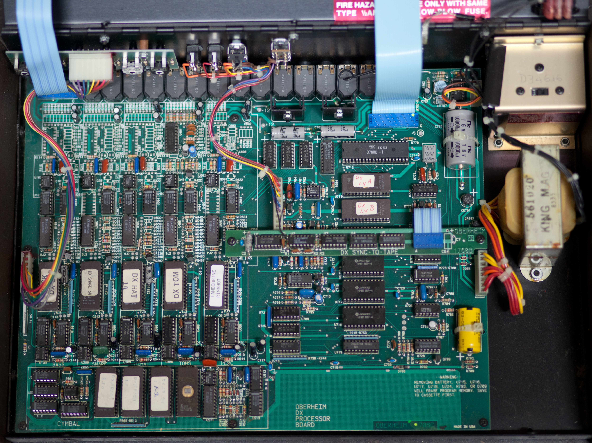
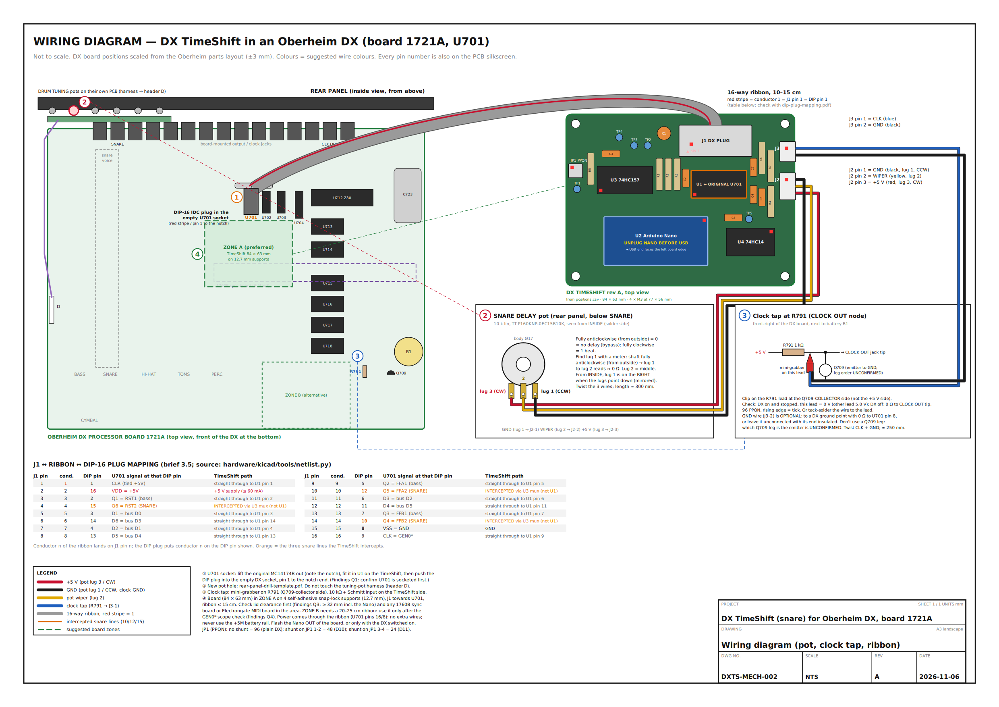
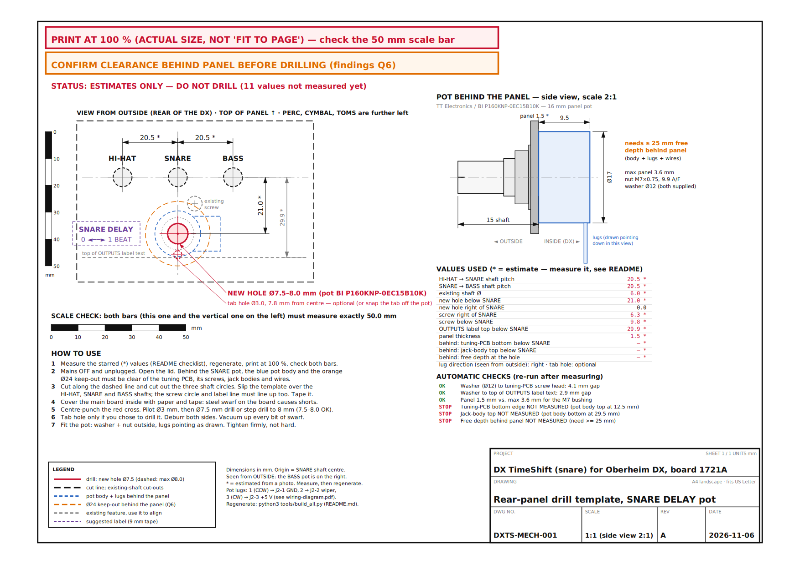

# 03. Install in the DX

**Where you are in the process:** step 12 of the order of work in
[00-start-here.md](00-start-here.md). The TimeShift board is built, the Nano is programmed, the
ribbon cable has passed the continuity check, and the bench self-test has passed
([02-build-the-board.md](02-build-the-board.md)). Sections 1 to 6 of this document are also the
first inspection you do **before** ordering parts (steps 2 to 5 of the order of work).

> **You will need**
>
> * The finished TimeShift board, the tested ribbon cable, the four snap-lock supports (H1 to H4)
> * The SNARE DELAY pot (TT Electronics/BI P160KNP-0EC15B10K) with its nut and washer
> * JST-XH housings (3-way for J2, 2-way for J3), crimp contacts or pre-crimped leads
> * 22 AWG stranded wire in red, black, yellow and blue, heat-shrink, cable ties
> * A Pomona 3925 mini-grabber for the clock tap (a second one is optional, for ground)
> * Label tape for "SNARE DELAY  0 ◄──► 1 BEAT"
> * Phillips screwdriver, IC extractor or small flat screwdriver, anti-static wrist strap, torch
> * Multimeter, digital calipers, small steel rule, modelling clay
> * Centre punch, 3 mm drill, 7.5 mm drill or step drill, deburring tool, cutting oil
> * Masking tape, paper, vacuum cleaner
> * 10 mm socket or spanner, JST-XH crimp tool (unless you use pre-crimped leads), heat gun
> * A printer (for the drill template), and a computer with Python 3 (to regenerate it)
> * A phone or camera

## 1. Safety first

> **STOP AND CHECK**
> Read all of this section before you open the DX.

1. **Mains.** The DX has a mains transformer, a fuse and a line filter inside the case, on the
   right-hand side as you look at it from the front. Switch the DX off and **pull the mains plug
   out of the wall**. Being switched off is not enough.
2. **Wait.** The power supply has large capacitors (C723 is 10 000 µF). Wait at least one minute
   after unplugging.
3. **Save your patterns.** The DX keeps your patterns in battery-backed memory. A warning printed on
   the DX board says that removing the battery, U715 to U718, U724, R793 or D709 will erase the
   memory, and to save to cassette first. You will not touch any of these parts, but save the
   patterns to cassette anyway before you start.
4. **The memory battery (B1) and the +5M rail.** B1 is a small battery soldered to the board near
   the front right corner. It stays live even when the DX is unplugged. Do not let tools, clips or
   loose wires touch it. Never connect anything to the battery-backed "+5M" rail.
5. **Static (ESD).** U701 is a 1983 CMOS chip. Wear an anti-static wrist strap clipped to the bare
   metal of the DX chassis. Touch the chassis before you touch any chip. Hold chips by their ends.
6. **Never force a socket.** If a chip or plug does not go in easily, stop and look. Old sockets
   and 40-year-old chip legs bend and break.
7. **Take photos** at every step. They are your record for putting the DX back to stock.

## 2. Open the DX

1. Unplug the mains cable and all audio and footswitch cables.
2. Place the DX on a soft, clean surface with the front towards you.
3. Remove the **two screws on the front** of the case.
4. Open the lid. The front-panel assembly (buttons, display and sliders) is mounted in the lid and
   connects to the main board by ribbon cables. Open it gently and **do not strain those cables**.
   Support the lid so it cannot fall shut. How far your lid opens and how it is best supported is
   not documented in this repository; look before you lift.

## 3. Identify the board and U701



*An Oberheim DX main board, seen from above with the rear panel at the top. The title "OBERHEIM DX
PROCESSOR BOARD" is at the bottom centre. U701, U702 and U703 are the row of three 16-pin chips just
below the two 470 µF capacitors (C701 and C702) near the middle of the board, left of the Z80 (U712).
This unit also has a "DX SYNC-TO-TAPE" board (1760B) fitted across the middle. Photo: User:Autopilot,
Wikimedia Commons, CC BY-SA 3.0.*

1. **Model.** Read the title on the main board, bottom centre. It must say "OBERHEIM DX PROCESSOR
   BOARD" (drawing 1721A). If it says "DX 'A'" or drawing 1906, this is a DXa: **stop**. The rev A
   board does not fit. See Q0 in [05-bench-verification.md](05-bench-verification.md).
2. **Other boards.** Note whether any of these are fitted, and photograph them:
   * a "DX SYNC-TO-TAPE" board 1760B, on standoffs over the area between U705 and U714;
   * an Electrongate MIDI board, on standoffs over the Z80 area, with a ribbon into the Z80 socket;
   * a Stretch expander, with ribbons into a RAM socket and the U722 socket.
   These can be in the way of the TimeShift board. An Electrongate MIDI board also means different
   firmware (3.01), whose snare timing has not been analysed (Q8).
3. **U701.** Find the row of three 16-pin chips just below C701 and C702. The row sits to the left
   of U704 (a 74LS244) and the Z80 (U712). On the Oberheim parts layout the order is U701, U702,
   U703 from left to right, seen from the front, so U701 is the left-hand one. Confirm it by the
   "U701" printed on the board next to the chip. Check the marking: MC14174B (MC14174BCP), CD40174
   or 74C174.
4. **Photograph U701 close up** from above. Note which end has the **notch** (or dot). You need
   this to put the DIP plug in the right way and, later, to put U701 back.

## 4. Confirm U701 is in a socket (Q1)

1. Shine a torch along both sides of U701.
2. A **socket** shows a black plastic frame under the chip. The chip legs go down into metal
   contacts, and there are no solder fillets on top of the legs.
3. To be sure: put a small flat screwdriver **between the chip and the socket** (not between the
   socket and the board) at one end. Lever the chip up by about 0.5 mm. Do the same at the other end.
   Then press the chip back down firmly and evenly.
4. Write the result in the form in [05-bench-verification.md](05-bench-verification.md).

> **STOP AND CHECK**
> If U701 is **soldered** to the board (no socket), stop here. The only way to fit the TimeShift
> board is to desolder U701 and solder a DIP-16 socket in its place (TE 1-2199298-4, listed as a
> contingency in [bom.md](bom.md)). That is a permanent change to the original board, although the
> DX can still be returned to stock behaviour by plugging U701 into the new socket. **The owner must
> agree in writing before you do it.** It is a skilled job on a 40-year-old board: use a
> desoldering station, not a hand pump, and do not lift any pads.

## 5. Measure the clearance under the lid (Q3)

The TimeShift board needs room under the closed lid. The mechanical design allows about **32 mm**
of height at the board position: 12.7 mm supports plus the board, the Nano on its headers and the
cable connectors. (Source: [hardware/mechanical/README.md](../hardware/mechanical/README.md).)

1. Roll a column of modelling clay about **40 mm** tall and 10 mm across. (A 10 mm ball, as in the
   findings, only shows whether there is at least 10 mm. You need to know whether there is 32 mm.)
2. Stand it on the main board at the planned board position (ZONE A, section 6), on a piece of
   paper so it leaves no residue.
3. Close the lid gently. Do not force it. Open it again.
4. Measure the squashed height of the clay with calipers. That is the free height.
5. Repeat on top of U701 itself (this tells you how much room the DIP plug and ribbon have).
6. Write both heights in the form in [05-bench-verification.md](05-bench-verification.md).

> **STOP AND CHECK**
> If the free height at the board position is less than about 32 mm, do not install the board
> there. See Q3 in [05-bench-verification.md](05-bench-verification.md) for the options.

## 6. Choose where the board goes



*Wiring diagram (DXTS-MECH-002). ZONE A (green, marker 4) is the suggested position, directly in
front of U701 to U704. ZONE B (front right, near R791) is the alternative. DX board positions are
scaled from the Oberheim parts layout and are only good to about ±3 mm. Full PDF:
[hardware/mechanical/wiring-diagram.pdf](../hardware/mechanical/wiring-diagram.pdf).*

* **ZONE A (preferred):** directly in front of U701 to U704, with J1 DX PLUG facing U701. The
  10 to 15 cm ribbon reaches easily.
* **ZONE B (alternative):** the blank area at the front right, near R791. It needs a 20 to 25 cm
  ribbon. Use it **only** after the GEN0* scope check (Q4) shows the longer ribbon is clean.
* The board is 84 × 63 mm with four 3.2 mm holes on 77 × 56 mm centres. It stands on four
  **self-adhesive snap-lock supports** (12.7 mm). The adhesive feet need four clean, flat spots on
  the DX board with no components under them.
* Parts of the DX board will be under the TimeShift board. The tallest of them must stay clear of
  the TimeShift board's underside, where the soldered leads stick out by a millimetre or two. Check
  this by eye with the board held in place.
* Nothing may rest on the transformer, the large capacitor C723 or the battery B1.
* Keep the board away from any SYNC-TO-TAPE or MIDI board found in section 3.

## 7. Move U701 to the TimeShift board

> **STOP AND CHECK**
> Before you lift U701: mains unplugged, wrist strap on, photo of U701's notch taken.

1. Lever U701 out of its socket with an IC extractor, or with a small flat screwdriver between chip
   and socket: lift a little at one end, then a little at the other end, until it comes free. Keep
   it level so no leg bends.
2. Check all 16 legs are straight. Straighten any bent leg gently with flat-nosed pliers.
3. Push U701 into socket **U1** on the TimeShift board. Its notch goes to the **left** end of U1,
   where the silkscreen says "◄ NOTCH = PIN 1 END". Check that every leg goes into its contact and
   none folds under the chip.
4. Look at the empty U701 socket on the DX board. Check none of its contacts is bent or dirty.

## 8. Plug the DIP plug into the U701 socket

1. **Mark both parts first.** Put a dot of paint pen on the DIP plug body at **pin 1** (the red
   stripe end). Put a small piece of tape or a paint-pen dot on the DX board next to the **notch
   end** of the empty U701 socket (check it against your photo of U701).
2. Hold the DIP plug so its **pin 1 (the red stripe end, your dot)** is at the **notch end** of the
   empty U701 socket, the same end where U701's notch was in your photo.
3. Line up all 16 pins with the socket contacts.
4. Press down firmly and evenly until the plug is fully seated.
5. Look along both rows. No pin may be outside the socket or folded under, and the plug must not
   be offset by one row of pins.
6. Plug the IDC socket at the other end of the ribbon onto **J1 DX PLUG**. The key on the IDC socket
   fits the slot in J1's shroud; it only goes one way. The red stripe is then at J1 pin 1 (▲).

> **STOP AND CHECK**
> Red stripe = pin 1 at **both** ends: at the notch end of the DX's U701 socket and at the ▲ on J1.
> If the plug is in back to front, +5 V and ground land on the wrong pins of the DX.

### 8.1 MANDATORY check: the plug is not reversed or offset

The continuity tests in [02-build-the-board.md](02-build-the-board.md) check the cable, but they
cannot tell you how the plug sits in the DX. If the DIP plug is turned 180° in the U701 socket, plug
pin 16 (the TimeShift +5 V) lands on socket pin 8 (DX ground) and plug pin 8 (TimeShift ground)
lands on socket pin 16 (DX +5 V). The board is then powered backwards from a supply that can
deliver about 2.6 A (INFERRED). That would destroy the original U701 chip in U1, U3, U4 and the
Nano, could damage C1, and could load the DX's data bus. This check takes two minutes.

Do it with the **DX switched off and unplugged from the mains**. U701, U3, U4 and the Nano can
stay fitted. Set the meter to resistance (ohms).

The reference points on the DX side are the supply pins of **U702**, the chip next to the U701
socket. U701, U702 and U703 are all MC14174B chips (VERIFIED, photo), and on this chip type pin 16
is +5 V and pin 8 is ground. (That U702 runs from the same +5 V as U701 is INFERRED. Check 4 below
uses only VERIFIED connections.) If you have found the "+5 TEST PAD" on the DX board, you can use it
instead of U702 pin 16.

| # | Measure between | Must read | ✓ |
|---|---|---|---|
| 1 | TimeShift **TP4** (GND) and DX **U702 pin 8** (ground) | **less than 1 Ω** | ☐ |
| 2 | TimeShift **C1 + lead** (or the Nano's 5V pin) and DX **U702 pin 16** (+5 V) | **less than 1 Ω** | ☐ |
| 3 | TimeShift **TP4** (GND) and DX **U702 pin 16** (+5 V) | **NOT** near 0 Ω (the reading may climb slowly as capacitors charge) | ☐ |
| 4 | TimeShift **U1 pin 1** and TimeShift **C1 + lead** | **less than 1 Ω** (DX socket pins 1 and 16 are both +5 V, VERIFIED) | ☐ |

Probe U702 and U1 on the top of the chip legs, where they enter the socket. Be careful not to
short two legs with the probe tip.

> **STOP AND CHECK**
> Any other result means the plug is reversed or offset by a pin. Do **not** power the DX. Pull the
> plug out, check the pin 1 marks, and repeat section 8 and this check.

## 9. Mount the board

1. Snap the four supports into the board's corner holes.
2. Clean the four spots on the DX board where the feet will go (a little isopropyl alcohol on a
   cloth, then let it dry).
3. Hold the board in place in ZONE A, J1 facing U701. Check the ribbon is not tight, does not pull
   on the DIP plug and does not cross sharp edges or hot parts.
4. Peel the backing from the feet and press the board down.
5. Close the lid slowly and check nothing touches. Open it again.

## 10. The rear-panel pot



*Rear-panel drill template (DXTS-MECH-001), as shipped. Its STATUS line says "ESTIMATES ONLY: DO NOT
DRILL", because the values are scaled from a small photo. You must measure your panel, regenerate
the template and print it at 100 %. Full PDF:
[hardware/mechanical/rear-panel-drill-template.pdf](../hardware/mechanical/rear-panel-drill-template.pdf).*

The new hole goes **directly below the SNARE tuning pot**, in the blank band above the output-jack
labels. Seen from behind the DX, the six tuning pots are PERC, CYMBAL, TOMS, HI-HAT, SNARE, BASS from
left to right, so **SNARE is second from the right**. The tuning pots sit on a small circuit board
fixed behind the panel. The space behind the candidate hole is not known yet (Q6). Measure first.

### 10.1 Measure

Mains off and unplugged, lid open. "Outside" means looking at the rear of the DX, with the BASS pot
on your right. Use calipers and a steel rule. Write each value into
`hardware/mechanical/tools/panel_measurements.json` and set `"measured": true` for it.

| # | JSON key | What to measure | Default (photo estimate) |
|---|---|---|---|
| 1 | `pitch_hihat_snare_mm` | Outside: HI-HAT shaft centre to SNARE shaft centre (measure left edge to left edge) | 20.5 |
| 2 | `pitch_snare_bass_mm` | Outside: SNARE shaft centre to BASS shaft centre | 20.5 |
| 3 | `shaft_dia_mm` | Diameter of the tuning shafts. Also note knurled or slotted, and how far they stick out. | 6.0 |
| 4 | `screw_right_of_snare_mm`, `screw_below_snare_mm` | Outside: from the SNARE shaft centre to the centre of the screw head just below and to the right of it (it holds the tuning-pot board) | 6.3, 9.8 |
| 5 | `screw_head_dia_mm` | That screw head's diameter | 5.5 |
| 6 | `outputs_label_top_below_snare_mm` | Outside: SNARE shaft centre down to the top of the printed "SNARE" output-jack label | 29.9 |
| 7 | `panel_thickness_mm` | Panel sheet thickness at the edge of a jack hole. Must be 3.6 mm or less. | 1.5 |
| 8 | `tuning_pcb_bottom_below_snare_mm` | **Behind the panel:** from the SNARE shaft centre line down to the lowest edge of the tuning-pot board, its standoffs or any wire, within 15 mm either side | not measured |
| 9 | `jack_body_top_below_snare_mm` | **Behind the panel:** from the SNARE shaft centre line down to the top of the nearest jack body or anything else rising from the main board, near the planned hole | not measured |
| 10 | `free_depth_behind_panel_mm` | **Behind the panel**, at the planned hole: from the inside face of the panel to the first obstruction. Needs **25 mm or more**. | not measured |
| 11 | `new_hole_below_snare_mm` | **Your decision:** the hole centre. Midway between the screw head and the label, and so the 17 mm pot body fits between items 8 and 9 with at least 1 mm to spare each side. | 21.0 |
| 12 | `new_hole_right_of_snare_mm` | Keep 0 (directly below SNARE) unless something behind the panel is in the way | 0.0 |
| 13 | `lug_direction` | Which way the pot's solder lugs will point, seen from outside: `right` or `left` | right |
| 14 | `drill_tab_hole` | `false` = snap the pot's anti-rotation tab off. `true` = drill a 3.0 mm tab hole as well. | false |

Also confirm a free radius of at least **12 mm** around the hole behind the panel (Q6).

### 10.2 Regenerate and print the template

1. On a computer with Python 3, in the repository folder, run:

   ```sh
   pip install --user ezdxf cairosvg
   python3 hardware/mechanical/tools/build_all.py
   ```

   (Details and alternatives: [hardware/mechanical/README.md](../hardware/mechanical/README.md).)
2. Read the checks the script prints. Open `hardware/mechanical/rear-panel-drill-template.pdf`.
   Its STATUS line must say **"generated from measured values"**. If it says "ESTIMATES ONLY" or
   "A CHECK FAILED", do not drill.
3. Print it at **100 % / "actual size"**, never "fit to page".
4. Measure **both 50 mm scale bars** with the calipers. Both must be exactly 50.0 mm.
5. Cut along the dashed lines and cut out the three shaft circles.
6. Slip the template over the HI-HAT, SNARE and BASS shafts. The screw circle **and** the label line
   must also line up with the real panel. If anything does not line up, a measurement is wrong.
   Measure again.
7. Tape the template in place.

> **STOP AND CHECK**
> Look behind the panel once more, at the exact spot. There must be at least 25 mm of free depth
> and nothing within 12 mm of the hole centre: no tuning-pot board, screw, standoff, jack body or
> wire. The template STATUS must say "generated from measured values". Drilling is the only
> permanent change in this mod.

### 10.3 Drill

1. **Protect the DX.** Cover the main board inside the rear panel with paper and masking tape,
   especially below the hole. Steel swarf on the board causes short circuits.
2. Centre-punch the red cross on the template. Remove the template.
3. Drill a **3 mm pilot hole**. Low speed, a drop of cutting oil if the panel is steel.
4. Open it up to **7.5 mm** with a 7.5 mm drill or a step drill. (The pot needs 7.5 mm, +0.2 mm.
   The template says an 8 mm step is acceptable; the washer covers it.)
5. If you chose `drill_tab_hole = true`, drill the 3.0 mm tab hole at the position on the template.
6. Deburr the hole on both sides.
7. Remove the paper carefully, folding it inwards so the swarf stays in it. **Vacuum** the area,
   inside and out. Look for any metal particles on the main board with a torch.

### 10.4 Fit the pot

1. If you are not using a tab hole, snap the anti-rotation tab off the pot with pliers. An M7
   internal-tooth lock washer helps it stay put (see [bom.md](bom.md)).
2. Put the pot through from the inside, lugs pointing the way you chose (`lug_direction`).
3. Fit the washer and nut on the outside. Tighten firmly with a 10 mm socket, but not hard.
4. Stick the label **"SNARE DELAY  0 ◄──► 1 BEAT"** below or beside the pot.

### 10.5 Wire the pot to J2

Box 2 of the wiring diagram in section 6 ("SNARE DELAY pot (rear panel, below SNARE)") shows the
pot seen from inside the DX.

1. **Find lug 1.** Turn the shaft fully **anticlockwise** (as seen from outside). With the meter,
   find the outer lug that reads about **0 Ω** to the middle lug. That outer lug is **lug 1**. The
   middle lug is **lug 2** (wiper). The other outer lug is **lug 3**. Do not trust a picture for
   this: from inside the DX the lugs are mirrored.
2. Cut three wires about **300 mm** long: **black**, **yellow** and **red**. Twist them together
   loosely.
3. Solder:

| Pot lug | Wire colour | J2 pin | Signal |
|---|---|---|---|
| Lug 1 (anticlockwise end) | Black | **J2 pin 1** | GND |
| Lug 2 (wiper, middle) | Yellow | **J2 pin 2** | Wiper |
| Lug 3 (clockwise end) | Red | **J2 pin 3** | +5 V |

4. Slide heat-shrink over each lug joint and shrink it.
5. Crimp JST-XH contacts onto the other ends and push them into the **3-way XHP-3 housing**:
   black in position 1, yellow in 2, red in 3. Check the housing's position 1 marking against J2's
   pin 1 (square pad on the board). (Or use pre-crimped leads; see [bom.md](bom.md).)
6. Check with the meter before plugging in: housing position 1 to position 2 reads about 0 Ω with
   the shaft fully anticlockwise, and about 10 kΩ fully clockwise.
7. Plug the housing into **J2 POT**.

So: anticlockwise = 0 V on the wiper = 0 (BYPASS). Clockwise = 5 V = 1 beat.

## 11. The clock tap at R791 (J3)

The board needs the DX's tempo clock. It takes it from the lead of **R791** on the **Q709 collector**
side. This point carries the same signal as the CLOCK OUT jack tip (VERIFIED, DX schematic sheet 1).

### 11.1 Find R791 and Q709

* They are near the **front right** of the main board, close to the memory battery **B1** (DX
  parts layout; marker 3 on the wiring diagram). In the photo in section 3, Q709, R791 and R792 are
  close to the yellow battery B1, in the bottom right area of the board.
* **R791** is a 1 kΩ resistor (bands brown, black, red for a 4-band part). One end goes to +5 V.
  The other end goes to the Q709 collector and the CLOCK OUT jack tip.
* Confirm both parts by their printed reference on the board, not by position alone.

### 11.2 Find the right lead

1. **DX switched off and unplugged.** Put one meter probe on the **tip** of the CLOCK OUT jack (use
   a 1/4" jack plug with a wire, or touch the tip contact through the socket).
2. Touch the other probe on each lead of R791 in turn.
3. The lead that reads **0 Ω** to the jack tip is the **Q709 collector side**. This is the lead you
   want. The other lead reads about 1 kΩ (through the resistor).
4. Optional check later, with the DX on and the sequencer stopped: the correct lead reads about 0 V
   and the other lead reads 5.0 V. (If the DX sends clock ticks while stopped, which is TBC under
   Q5, the meter may read a little above 0 V.)
5. Mark the correct lead with a dot of paint pen or a small piece of tape on the board next to it.

### 11.3 Make and fit the clock lead

1. Cut a **blue** wire (clock) and a **black** wire (ground), each about **250 mm**. Twist them
   together.
2. Crimp JST-XH contacts on one end and fit them into the **2-way XHP-2 housing**: **blue in
   position 1**, **black in position 2**. Check position 1 against J3's square pad.
3. Solder the other end of the blue wire to a **Pomona 3925 mini-grabber** and cover the joint with
   heat-shrink.
4. Clip the grabber onto the **R791 lead on the Q709-collector side** (the one you marked). Make
   sure the hook touches only that lead and nothing else, and cannot reach battery B1.
5. **Alternative:** tack-solder the blue wire to that resistor lead instead of using a grabber.
   Use a small amount of solder and a quick joint, and do not disturb the resistor's own joint.
   This is reversible: desolder the wire to remove it.
6. **The black ground wire is optional.** The board already gets ground through the ribbon.
   * If you use it: clip it to a point that reads **0 Ω to U701 socket pin 8** (or TP4 on the
     TimeShift board). The web walkthrough suggests the Q709 emitter; the schematic shows the
     emitter goes to ground, but which leg is the emitter on your board is TBC. Check with the meter
     before clipping.
   * If you do not use it: cut it short and insulate the end with heat-shrink.
7. Plug the housing into **J3 CLK**.

### 11.4 Strain relief

* Tie the clock lead to something fixed with a cable tie, about 3 to 5 cm from the grabber, so that
  a pull on the lead cannot pull the grabber off.
* Route it away from the transformer and the power-supply corner.

## 12. Dress the cables

1. Run the pot lead (300 mm) and the clock lead (250 mm) along the board edges, away from the
   transformer, the mains wiring and the large capacitor C723.
2. Tie them down loosely with cable ties so they cannot be caught by the lid.
3. The ribbon must lie flat with a gentle curve. It must not be pinched by the lid or stretched.
4. Close the lid slowly and watch every cable. Nothing may be squashed. Open it again.

## 13. Close-up checklist before power-on

> **STOP AND CHECK**
> Tick every line before you connect the mains.

| ✓ | Check |
|---|---|
| ☐ | Main board is 1721A ("OBERHEIM DX PROCESSOR BOARD"), not a DXa. |
| ☐ | The ribbon cable passed continuity tests A to D. |
| ☐ | Original U701 is in **U1** on the TimeShift board, notch at the left ("NOTCH = PIN 1 END"). |
| ☐ | U3 notch left, U4 notch right, both seated. Nano USB end left, all pins seated. |
| ☐ | DIP plug fully seated in the DX's U701 socket, **red stripe / pin 1 at the notch end**. No bent pins. |
| ☐ | **Reversed-plug check (section 8.1) passed:** TP4 to U702 pin 8 under 1 Ω, C1 + to U702 pin 16 under 1 Ω, TP4 to U702 pin 16 not near 0 Ω, U1 pin 1 to C1 + under 1 Ω. |
| ☐ | IDC socket on J1, red stripe at ▲ pin 1. |
| ☐ | Pot lead on J2: lug 1 black to pin 1 (GND), lug 2 yellow to pin 2, lug 3 red to pin 3 (+5 V). |
| ☐ | Pot turned **fully anticlockwise** (BYPASS). |
| ☐ | Clock grabber on the R791 lead that reads 0 Ω to the CLOCK OUT tip. It touches nothing else. Lead on J3: blue pin 1, black pin 2 (or black insulated). |
| ☐ | JP1 shunt on one pin only (96 PPQN) for a plain DX. |
| ☐ | **No USB cable** is plugged into the Nano. |
| ☐ | No swarf, wire offcuts or tools inside the DX. |
| ☐ | Nothing touches battery B1, the transformer or C723. |
| ☐ | Lid closes without squashing anything. |

Next: [04-test-and-calibrate.md](04-test-and-calibrate.md).
