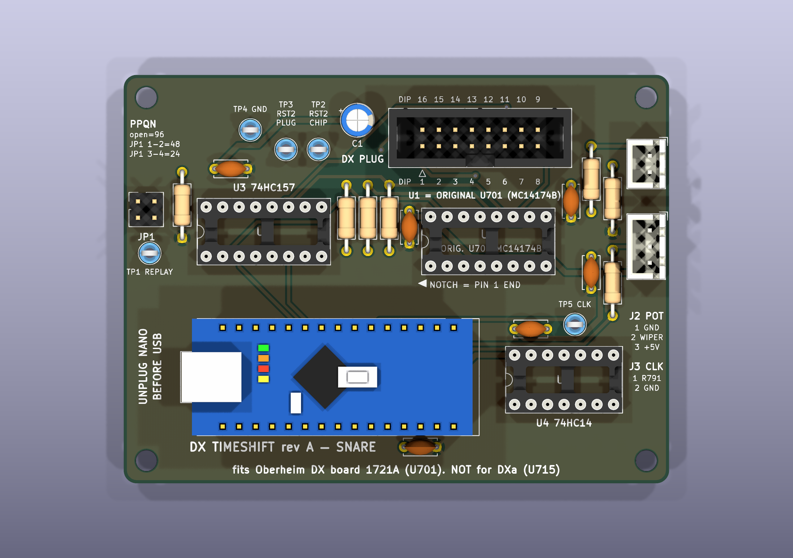

# DX TimeShift rev A: hardware

This folder holds the complete KiCad 9 design of the DX TimeShift board (snare delay
interposer for the Oberheim DX, board 1721A, socket U701). It also holds every file made
from that design. The circuit is exactly PROJECT_BRIEF.md section 3.5 (LOCKED). The signal
facts behind it are in `docs/research/dx-findings.md` sections b, c, d and h.

> **Fits Oberheim DX board 1721A (U701). NOT for the DXa (board 1906, U715).**
> **UNPLUG NANO BEFORE USB.** The Nano's 5 V pin is wired to the DX logic rail. Flash the Nano
> while it is OUT of the board, or only while the DX is switched on.



## 1. What each file is

| Path | What it is |
|---|---|
| `kicad/timeshift/timeshift.kicad_pro` | KiCad 9 project. Open this file in KiCad. |
| `kicad/timeshift/timeshift.kicad_sch` | Schematic, one A3 sheet in blocks A to F. Every library symbol is embedded. |
| `kicad/timeshift/timeshift.kicad_pcb` | PCB: 2 layers, fully routed, GND pours on both layers |
| `kicad/timeshift/timeshift.kicad_sym`, `sym-lib-table` | Project symbol library. It has one symbol, J1 `DX_PLUG_2x08`. |
| `kicad/timeshift/timeshift.pretty/Arduino_Nano_Socketed.kicad_mod`, `fp-lib-table` | Project footprint: `Module:Arduino_Nano` with identical pads, plus 3D models of the Nano and its two 1x15 female headers |
| `kicad/timeshift/3d/Arduino_Nano_v3_on_sockets.step` | Simple colour 3D model of a Nano v3 on sockets. The KiCad library has no Nano model. |
| `kicad/timeshift/reports/erc.rpt` | ERC report: **0 errors, 0 warnings** (all severities) |
| `kicad/timeshift/reports/drc.rpt` | DRC report, including schematic parity: **0 violations, 0 unconnected, 0 parity issues** (all severities) |
| `kicad/timeshift/reports/timeshift.net` | Netlist exported from the schematic. The PCB is built from it. |
| `kicad/tools/` | Generator scripts. The whole design is rebuilt from `netlist.py` (section 3). |
| `kicad/3dmodels-cache/` | The KiCad 9 library 3D models this board uses (3.7 MB). **Committed to the repo**, so renders, GLB and STEP rebuild offline. `fetch_3dmodels.sh` re-downloads any that are missing. |
| `exports/schematic.pdf`, `exports/schematic.svg` | Schematic for printing or viewing |
| `exports/pcb-top.svg`, `exports/pcb-bottom.svg` | Copper + mask + silkscreen + outline, top and bottom (the bottom view is mirrored) |
| `exports/fab-assembly-top.pdf` | Fab/assembly drawing: F.Fab + F.Silkscreen + Edge.Cuts with title block |
| `exports/board.glb` | 3D model with tracks, pads, zones, silkscreen, soldermask and component models. It is used by the web app. |
| `exports/board.step` | 3D STEP of the assembled board, for mechanical CAD |
| `exports/bom.csv` | BOM exported from the schematic, grouped by value and footprint, with part numbers. The J1 cable row names the DIP-16 IDC plug as **Adam Tech FDP-316-T** (alternative HARTING 09181169622), the same part as `docs/bom.csv`. |
| `exports/positions.csv` | Component positions (mm, KiCad coordinates, top side) |
| `gerbers/timeshift-revA-gerbers.zip` | **Upload this to JLCPCB/PCBWay.** See `gerbers/README.md` for order settings. |
| `renders/top.png`, `bottom.png`, `perspective.png`, `perspective-2.png` | 3D renders, 2384 x 1680 px, high quality |
| `renders/top-bare-board.png` | Top render without parts, so all the silkscreen is visible |
| `renders/assembly-diagram.svg` / `.png` | **Labelled top view for assembly.** Every connector, IC and test point has a callout. |

## 2. The board at a glance

* 84.0 x 63.0 mm, 2 layers, FR-4 1.6 mm, all parts through-hole, 4 x M3 (3.2 mm) mounting
  holes 3.5 mm in from each corner (hole centres 77.0 x 56.0 mm apart).
* Tracks are 0.5 mm for signals and 0.8 mm for +5V. Clearance is 0.2 mm. Vias are 1.0/0.5 mm.
  Copper is kept 0.5 mm from the board edge.
* GND is carried by a copper pour on the **bottom** (the main plane, as the brief asks). A
  second GND pour on the top joins the bottom islands that the tracks cut off. Every GND pad
  has at least two thermal spokes or a solid connection.
* Layout (top view): J1 "DX PLUG" is top centre, with U1 (socket for the original U701)
  directly below it. U3 (74HC157) is on the left and the 1 k resistors R1 to R3 sit between
  U3 and U1. The Nano is across the bottom with its USB end on the LEFT. U4 (74HC14) is
  bottom right. **All three DIP sockets (U1, U3, U4) have their notch / pin 1 at the LEFT
  end.** J3 "CLK" and J2 "POT" are on the right edge. The PPQN jumper JP1 is at the left
  edge. Test points TP2/TP3/TP4 are next to J1, TP1 is at the left edge and TP5 is next to
  U4.
* Decoupling sits at the pins it serves. C2 is about 3 mm from U1 pin 16 and C3 about 6 mm
  from U3 pin 16. C4's +5V pad is 4.0 mm from U4 pin 14 (VCC). C5 is just below the Nano:
  its +5V pad is 3.2 mm from Nano pin 27 (+5V) and its GND pad 3.2 mm from pin 29 (GND).

## 3. How to open and how to regenerate

**Open:** install KiCad 9 and open `kicad/timeshift/timeshift.kicad_pro`. The project
libraries (`timeshift.kicad_sym`, `timeshift.pretty`) are found through `${KIPRJMOD}`. All
other symbols and footprints come from the standard KiCad 9 libraries.

**Regenerate everything** with Docker. This rebuilds the libraries, schematic, ERC, netlist
check, PCB, autorouting, pours, DRC, all exports, Gerbers, renders and the diagram:

```sh
docker pull kicad/kicad:9.0
docker pull ghcr.io/freerouting/freerouting:latest
hardware/kicad/tools/build_all.sh            # about 8 minutes, mostly the 3D renders
```

The 3D models come from the committed `hardware/kicad/3dmodels-cache/` (3.7 MB).
`build_all.sh` only downloads models that are missing there, so the build needs no network
access for them. It does need the two Docker images.

If Docker cannot bind-mount your checkout (for example, you are working inside a container),
start a helper container once and use copy mode. Copy mode only syncs `hardware/kicad`,
`exports`, `gerbers` and `renders`:

```sh
docker run -d --name kicadws kicad/kicad:9.0 sleep infinity
KX_MODE=copy hardware/kicad/tools/build_all.sh
```

Single steps, run from the repository root (this is what `tools/kx.sh` does):

```sh
K='docker run --rm --user '"$(id -u):$(id -g)"' -e HOME=/tmp -e KICAD9_3DMODEL_DIR=/work/hardware/kicad/3dmodels-cache -v '"$PWD"':/work -w /work kicad/kicad:9.0'
$K kicad-cli sch erc --severity-all -o hardware/kicad/timeshift/reports/erc.rpt hardware/kicad/timeshift/timeshift.kicad_sch
$K kicad-cli pcb drc --schematic-parity --severity-all -o hardware/kicad/timeshift/reports/drc.rpt hardware/kicad/timeshift/timeshift.kicad_pcb
$K kicad-cli sch export pdf -o hardware/exports/schematic.pdf hardware/kicad/timeshift/timeshift.kicad_sch
$K kicad-cli pcb export glb -f --subst-models --include-tracks --include-pads --include-zones --include-silkscreen --include-soldermask -o hardware/exports/board.glb hardware/kicad/timeshift/timeshift.kicad_pcb
$K kicad-cli pcb render --quality high --side top -w 2400 -h 1700 -o hardware/renders/top.png hardware/kicad/timeshift/timeshift.kicad_pcb
$K python3 hardware/kicad/tools/gen_pcb.py      # pcbnew Python API is available in the image
```

### The generator scripts (`kicad/tools/`)

| Script | Job |
|---|---|
| `netlist.py` | **Single source of truth:** every part, value, footprint, part number and pin-to-net assignment (= brief 3.5). The header-to-DIP mapping `HDR2DIP` is here. |
| `gen_libs.py` | Writes the J1 symbol (pin number = header pin, pin name = DIP pin), the socketed Nano footprint and the lib tables |
| `gen_project.py` | Writes `timeshift.kicad_pro`: net classes (Default 0.5 mm, Power 0.8 mm) and design rules |
| `gen_schematic.py` | Draws the schematic from `netlist.py`, using KiCad standard symbols embedded in the file |
| `check_netlist.py` | Compares the netlist KiCad exports from the schematic with `netlist.py`, net by net. The build stops on any difference. |
| `gen_pcb.py` + `silk.py` | Places the footprints and assigns nets from the exported netlist, so the PCB links to the schematic like "Update PCB from Schematic". Then it adds the outline and silkscreen and writes the Specctra DSN. |
| `route.sh` | Autoroutes with Freerouting in Docker. Neck-down is off, so every track keeps its class width. Freerouting is not fully deterministic, so the script retries (up to 5 runs) until 0 connections are unrouted. |
| `finish_pcb.py` | Imports the routes and adds and fills the GND pours. It gives a pad a solid zone connection where only one thermal spoke would fit. |
| `exports.sh` | All `kicad-cli` exports, Gerbers + drill files + zip, and 3D renders |
| `gen_diagram.py` | Draws the labelled assembly diagram from the real board data |
| `make_nano_3d.py` | Builds the Nano 3D model with CadQuery. It runs on the host and is optional, because the STEP file is committed. |
| `fetch_3dmodels.sh` | Downloads the KiCad 9 library 3D models this board uses (the Docker image ships without them) |
| `preview.py`, `bare_board.py` | Debug preview SVG and a model-less copy of the board for the bare-board render |

## 4. Design decisions

1. **Netlist first.** `netlist.py` is written straight from brief 3.5. The schematic is drawn
   from it, and KiCad's exported netlist must match it exactly (`check_netlist.py`). The PCB
   then takes its nets from that exported netlist, and DRC schematic parity confirms the PCB
   matches the schematic. So the brief, the schematic and the PCB cannot drift apart.
2. **J1 uses DIP pin numbers.** J1's symbol pin *numbers* are the box-header pins, which are
   also the ribbon conductors. Its pin *names* are `DIP1`...`DIP16`, the DIP-16 plug pin each
   header pin lands on. The symbol is drawn in DIP order, so it reads like U701. Net names say
   which U701 pin they carry (`U701_9_~{GEN0}`, `RST2_PLUG` = DIP 15, ...). The silkscreen
   also prints the DIP pin number next to every header pin ("DIP 16 15 ... 9" above,
   "DIP 1 2 ... 8" below).
3. **Interception is complete.** U1 pins 10/12/15 go only to the 74HC157 A inputs and,
   through R1 to R3 (1 k), to the Nano. J1 DIP 10/12/15 are driven only by the 74HC157 Y
   outputs. The other 13 pins go straight from J1 to U1 on the same DIP number.
4. **Fail-safe bypass.** R5 (10 k) pulls the mux select low, which selects the A inputs
   (bypass). A missing, blank, crashed or resetting Nano therefore leaves the DX stock.
5. **Clock input.** J3 pin 1 feeds R6 (10 k series). The node has R7 (100 k) to GND and C7
   (1 nF) to GND, then goes through two 74HC14 inverters in series to CLK_IN (D3). The
   output is non-inverting, so a rising edge at R791 is a rising edge at D3. The four unused
   74HC14 inputs are tied to GND.
6. **Power** comes only from J1 (DIP16 = +5 V, DIP8 = GND). C1 (10 µF) is next to J1, and
   there is a 100 nF cap at the supply pins of each of U1 (C2), U3 (C3), U4 (C4, 4 mm from
   pin 14) and the Nano (C5, 3 mm from pins 27/29). The board has no ±12 V.
7. **Removable parts.** Every IC is socketed. The Nano plugs into two 1x15 female headers.
   U1 is only a socket: it holds the original U701 chip taken out of the DX. Its notch is
   marked "NOTCH = PIN 1 END" with an arrow, and silk text reads
   "U1 = ORIGINAL U701 (MC14174B)". U1, U3 and U4 all face the same way, with the notch at the
   left end, so no chip is the odd one out. A chip fitted backwards swaps pins 7/8 and 14/16
   and reverse-powers itself.
8. **Autorouting.** Freerouting routes the signal and +5V nets at the full 0.5/0.8 mm widths
   (neck-down off). The GND pours carry GND. The board was enlarged to 84 x 63 mm so that
   everything routes at those widths (see section 7).

## 5. Design review against PROJECT_BRIEF.md 3.5 (LOCKED)

| # | LOCKED requirement (brief 3.5) | How the design meets it |
|---|---|---|
| 1 | Nano D2 (INT0) = RST2_IN from U701 pin 15 | U1.15 `RST2_CHIP` → R1 1 k → `RST2_IN` → U2 pin 5 (D2) |
| 2 | D3 (INT1) = CLK_IN after the Schmitt buffer | U4 pin 4 (2nd gate) → `CLK_IN` → U2 pin 6 (D3), TP5 |
| 3 | D4 = FFA2_IN from U701 pin 12 | U1.12 `FFA2_CHIP` → R2 1 k → `FFA2_IN` → U2 pin 7 (D4) |
| 4 | D5 = FFB2_IN from U701 pin 10 | U1.10 `FFB2_CHIP` → R3 1 k → `FFB2_IN` → U2 pin 8 (D5) |
| 5 | D6 = RST2_OUT → 74HC157 1B | U2 pin 9 (D6) → U3 pin 3 (1B) |
| 6 | D7 = FFA2_OUT → 2B | U2 pin 10 (D7) → U3 pin 6 (2B) |
| 7 | D8 = FFB2_OUT → 3B | U2 pin 11 (D8) → U3 pin 10 (3B) |
| 8 | D9 = MUX_SEL → U3 pin 1 (S), 10 k pull-down = bypass | U2 pin 12 (D9) → U3 pin 1, R5 10 k to GND |
| 9 | D10/D11 = PPQN_J1/J2, jumper to GND (internal pull-ups) | U2 pin 13 (D10) → JP1 pin 1 and U2 pin 14 (D11) → JP1 pin 3. JP1 pins 2/4 = GND. The positions are called **"JP1 1-2"** (D10, closed = 48 PPQN) and **"JP1 3-4"** (D11, closed = 24 PPQN); both open = 96. The silkscreen says "PPQN / open=96 / JP1 1-2=48 / JP1 3-4=24". J1 and J2 are connectors, never jumper names. |
| 10 | D12 = TP_REPLAY test point | U2 pin 15 (D12) → TP1 "REPLAY" |
| 11 | D13 = LED_ACT on-board LED | The Nano's own "L" LED. Nothing external is needed, so U2 pin 16 has a no-connect flag and a note in the schematic. |
| 12 | A0 = POT_W via 1 k series + 100 nF to GND | J2.2 → R4 1 k → `POT_W` → U2 pin 19 (A0). C6 100 nF from `POT_W` to GND. |
| 13 | 74HC157 /E (pin 15) = GND | U3.15 = GND |
| 14 | ch1: 1A = RST2 chip, 1B = RST2_OUT, 1Y → plug pin 15 | U3.2 = `RST2_CHIP`, U3.3 = `RST2_OUT`, U3.4 → `RST2_PLUG` → J1 header pin 4 = DIP 15, TP3 |
| 15 | ch2: 2A = FFA2 chip, 2B = FFA2_OUT, 2Y → plug pin 12 | U3.5, U3.6, U3.7 → `FFA2_PLUG` → J1 header pin 10 = DIP 12 |
| 16 | ch3: 3A = FFB2 chip, 3B = FFB2_OUT, 3Y → plug pin 10 | U3.11, U3.10, U3.9 → `FFB2_PLUG` → J1 header pin 14 = DIP 10 |
| 17 | ch4 unused: 4A, 4B to GND, 4Y n/c | U3.14, U3.13 = GND. U3.12 has a no-connect flag. |
| 18 | 74HC14: J_CLK.1 → 10 k → node (100 k + 1 nF to GND) → gate 1 → gate 2 → CLK_IN, unused inputs GND | J3.1 → R6 10 k → `CLK_RC` (R7 100 k, C7 1 nF) → U4.1 → U4.2/U4.3 → U4.4 = `CLK_IN`. U4 pins 5, 9, 11, 13 = GND. Outputs 6, 8, 10, 12 are not connected. |
| 19 | U1 = DIP-16 socket for the original U701 | `Package_DIP:DIP-16_W7.62mm_Socket`, value "MC14174B (orig. U701)" |
| 20 | U1 pins 1–9, 11, 13, 14, 16 straight to the same J1 DIP pin | 13 nets `U701_n_...`/`+5V`/`GND`. Each joins U1 pin n to the J1 header pin that lands on DIP n (table in section 6). Proven by `check_netlist.py` + DRC parity. |
| 21 | U1 pins 10/12/15 only to the Nano inputs (via 1 k) and the mux A inputs | `*_CHIP` nets hold only U1, U3 A input, R1/R2/R3 (and TP2 on RST2). They have no connection to J1. |
| 22 | J1 pins 10/12/15 driven only by the mux Y outputs | `*_PLUG` nets hold only U3 Y, J1 (and TP3 on RST2) |
| 23 | J1 = 2x8 shrouded box header, pin 1 marked | `Connector_IDC:IDC-Header_2x08_P2.54mm_Vertical`. Pin 1 has a square pad and a ▲ silk mark. Label "DX PLUG". |
| 24 | Standard DIP IDC mapping, and J1 schematic nets already use DIP pin numbers | J1 pin names are DIP1...DIP16 per the mapping. Net names carry the U701 pin. Silk prints the DIP number at every header pin. The mapping is also printed on the back silkscreen. |
| 25 | J2 "POT" JST-XH 3: 1 GND (CCW), 2 wiper, 3 +5 V (CW) | `JST_XH_B3B-XH-A_1x03_P2.50mm_Vertical`. Silk "J2 POT 1 GND 2 WIPER 3 +5V". |
| 26 | J3 "CLK" JST-XH 2: 1 CLK (R791 lead), 2 GND | `JST_XH_B2B-XH-A_1x02_P2.50mm_Vertical`. Silk "J3 CLK 1 R791 2 GND". |
| 27 | JP1 2x2 header for PPQN_J1/J2 to GND | `PinHeader_2x02_P2.54mm_Vertical`, with the silk legend "PPQN / open=96 / JP1 1-2=48 / JP1 3-4=24" |
| 28 | TP1 = TP_REPLAY, TP2 = RST2 chip, TP3 = RST2 plug, TP4 = GND, TP5 = CLK_IN | Exactly these, as Keystone 5005 compact loops, each named on the silkscreen |
| 29 | C_bulk 10 µF at J1; 100 nF next to U1, U3, U4 and the Nano | C1 10 µF beside J1. C2 is 3 mm from U1 pin 16 and C3 6 mm from U3 pin 16. C4's +5V pad is 4.0 mm from U4 pin 14. C5 is right below the Nano, 3.2 mm from pin 27 (+5V) and 3.2 mm from pin 29 (GND). |
| 30 | Power only from U701 pins 16/8 via the plug, no ±12 V | +5V and GND enter only through J1 header pins 2 (DIP16) and 15 (DIP8) |
| 31 | 2 layers, about 65 x 40 mm, 4 x M3 at the corners, all through-hole | 2 layers, all THT, 4 x M3 at the corners. **Size is 84 x 63 mm**, see section 7. |
| 32 | Silk: "DX TIMESHIFT rev A — SNARE — fits Oberheim DX board 1721A (U701). NOT for DXa (U715)" | Two lines along the bottom edge: "DX TIMESHIFT rev A — SNARE" / "fits Oberheim DX board 1721A (U701). NOT for DXa (U715)". The back silkscreen repeats the model warning. |
| 33 | Nano on two 1x15 female headers, removable | Footprint `timeshift:Arduino_Nano_Socketed` (pads identical to `Module:Arduino_Nano`). The BOM lists the sockets. |
| 34 | "UNPLUG NANO BEFORE USB" next to the Nano | Printed in bold at the Nano's USB end, which is the left board edge |

## 6. Ribbon / DIP plug mapping and the as-built pin/net table

A 16-way ribbon goes from J1 to a DIP-16 IDC plug in the DX's U701 socket. Ribbon conductor
*n* lands on header pin *n*. **J1's pin labels (schematic pin names and PCB silkscreen numbers)
already use the DIP pin numbers after this mapping.**

**TO BE CONFIRMED on the bench (a mandatory step before first power-up):** with the cable made
up and nothing plugged in, use a continuity meter to check every pair in the table below.
Check DIP 16 = +5 V and DIP 8 = GND above all.

| J1 header pin = ribbon conductor | DIP plug pin = U701 socket pin | Net on the TimeShift board | U701 / DX signal (findings b1) | U1 pin on the board |
|---|---|---|---|---|
| 1 | 1 | `U701_1_~{CLR}` | CLR, tied to +5 V in the DX | 1 (same net) |
| 2 | 16 | `+5V` | VDD +5 V (supplies the board) | 16 (same net) |
| 3 | 2 | `U701_2_RST1` | Q1 = RST1 (bass) | 2 (same net) |
| 4 | 15 | `RST2_PLUG` (mux 1Y) | Q6 = RST2 (snare), **intercepted** | 15 = `RST2_CHIP` |
| 5 | 3 | `U701_3_BUS_D0` | D1 input = data bus D0 | 3 (same net) |
| 6 | 14 | `U701_14_BUS_D3` | D6 input = data bus D3 | 14 (same net) |
| 7 | 4 | `U701_4_BUS_D1` | D2 input = data bus D1 | 4 (same net) |
| 8 | 13 | `U701_13_BUS_D4` | D5 input = data bus D4 | 13 (same net) |
| 9 | 5 | `U701_5_FFA1` | Q2 = FFA1 (bass) | 5 (same net) |
| 10 | 12 | `FFA2_PLUG` (mux 2Y) | Q5 = FFA2 (snare), **intercepted** | 12 = `FFA2_CHIP` |
| 11 | 6 | `U701_6_BUS_D2` | D3 input = data bus D2 | 6 (same net) |
| 12 | 11 | `U701_11_BUS_D5` | D4 input = data bus D5 | 11 (same net) |
| 13 | 7 | `U701_7_FFB1` | Q3 = FFB1 (bass) | 7 (same net) |
| 14 | 10 | `FFB2_PLUG` (mux 3Y) | Q4 = FFB2 (snare), **intercepted** | 10 = `FFB2_CHIP` |
| 15 | 8 | `GND` | VSS (board ground) | 8 (same net) |
| 16 | 9 | `U701_9_~{GEN0}` | CLK = GEN0* write strobe | 9 (same net) |

Every net on the board as built (in KiCad, local nets carry a leading `/`):

| Net | Members (ref.pin, Nano pin name) |
|---|---|
| `+5V` | U1.16, U2.27 (+5V), U3.16, U4.14, J1.2, J2.3, C1.1, C2.1, C3.1, C4.1, C5.1 |
| `GND` | U1.8, U2.4, U2.29, U3.8, U3.13, U3.14, U3.15, U4.5, U4.7, U4.9, U4.11, U4.13, J1.15, J2.1, J3.2, JP1.2, JP1.4, R5.2, R7.2, C1.2, C2.2, C3.2, C4.2, C5.2, C6.2, C7.2, TP4.1 |
| `RST2_CHIP` | U1.15, U3.2 (1A), R1.1, TP2.1 |
| `RST2_IN` | U2.5 (D2), R1.2 |
| `RST2_OUT` | U2.9 (D6), U3.3 (1B) |
| `RST2_PLUG` | U3.4 (1Y), J1.4 (DIP15), TP3.1 |
| `FFA2_CHIP` | U1.12, U3.5 (2A), R2.1 |
| `FFA2_IN` | U2.7 (D4), R2.2 |
| `FFA2_OUT` | U2.10 (D7), U3.6 (2B) |
| `FFA2_PLUG` | U3.7 (2Y), J1.10 (DIP12) |
| `FFB2_CHIP` | U1.10, U3.11 (3A), R3.1 |
| `FFB2_IN` | U2.8 (D5), R3.2 |
| `FFB2_OUT` | U2.11 (D8), U3.10 (3B) |
| `FFB2_PLUG` | U3.9 (3Y), J1.14 (DIP10) |
| `MUX_SEL` | U2.12 (D9), U3.1 (S), R5.1 |
| `PPQN_J1` | U2.13 (D10), JP1.1 |
| `PPQN_J2` | U2.14 (D11), JP1.3 |
| `TP_REPLAY` | U2.15 (D12), TP1.1 |
| `POT_WIPER` | J2.2, R4.1 |
| `POT_W` | U2.19 (A0), R4.2, C6.1 |
| `CLK_TAP` | J3.1, R6.1 |
| `CLK_RC` | R6.2, R7.1, C7.1, U4.1 |
| `CLK_INV` | U4.2, U4.3 |
| `CLK_IN` | U4.4, U2.6 (D3), TP5.1 |
| `U701_1_~{CLR}` | U1.1, J1.1 |
| `U701_2_RST1` | U1.2, J1.3 |
| `U701_3_BUS_D0` | U1.3, J1.5 |
| `U701_4_BUS_D1` | U1.4, J1.7 |
| `U701_5_FFA1` | U1.5, J1.9 |
| `U701_6_BUS_D2` | U1.6, J1.11 |
| `U701_7_FFB1` | U1.7, J1.13 |
| `U701_9_~{GEN0}` | U1.9, J1.16 |
| `U701_11_BUS_D5` | U1.11, J1.12 |
| `U701_13_BUS_D4` | U1.13, J1.8 |
| `U701_14_BUS_D3` | U1.14, J1.6 |
| not connected (no-connect flag) | U2: D0, D1, both RESET, 3V3, AREF, A1–A7, D13 (= on-board LED), VIN. U3.12 (4Y). U4 outputs 6, 8, 10, 12. |

## 7. Check results, warnings and deviations from the brief

* **ERC** (`kicad-cli sch erc --severity-all`): 0 errors, 0 warnings, nothing excluded. Only
  GND has a PWR_FLAG. +5V is already driven by the Nano symbol's `+5V` pin, which is a power
  output, and a PWR_FLAG there would clash with it. In the real circuit +5 V comes from the DX
  through J1 DIP16.
* **DRC** (`kicad-cli pcb drc --schematic-parity --severity-all`): 0 violations, 0 unconnected
  items, 0 schematic-parity issues, nothing excluded. That includes silkscreen overlap,
  silkscreen on pads, edge clearance and text size.
* **Deviation: board size.** The board is 84 x 63 mm instead of about 65 x 40 mm. The parts
  alone cover about 2,600 mm²: the Nano with its 46 x 18 mm footprint, three DIP sockets, a
  29 mm long box header, seven 10 mm axial resistors, five test points and four corner holes.
  That is already the whole 65 x 40 area, before any routing. The brief allows growth if
  needed. The ribbon (10 to 15 cm) lets the board sit anywhere convenient inside the DX case.
* **Addition: a second GND pour on the top layer.** The brief asks for a GND pour on the
  bottom, and that is the main plane. A top pour was added because signal tracks on the
  bottom cut it into islands. Three GND pads (J1.15, C1.2, U2.4) have a solid zone connection
  instead of thermal spokes, because the pours can only reach them with one spoke. They need
  a little more heat when soldering.
* **Choices allowed by the brief:** the test points are Keystone 5005 compact loops (THT). The
  Nano footprint is a project copy of `Module:Arduino_Nano` with the same pads, plus 3D models
  of the Nano and its female headers. The U1 and U3 symbols are KiCad's `74LS174` and
  `74LS157`, which have the same pinout as MC14174B and 74HC157. The value fields carry the
  real part.
* **3D models.** The DIP sockets, box header, JST connectors, pin header, resistors,
  capacitors, test points and female headers use the official KiCad 9 models. The Nano model
  is a simplified one made for this project (board, ATmega, USB connector, LEDs, pins), with
  the right size and pin positions.
* **Still TO BE CONFIRMED on the bench** (from the brief and findings, not from this board):
  that U701 is socketed (findings Q1), the ribbon/IDC mapping (continuity check above), the
  RST2 pulse width (Q2), the CLOCK OUT tap at R791 (Q5), and the +5 V drop at U701 pin 16
  (Q7).
