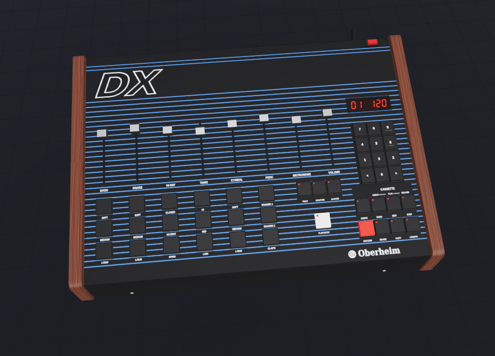

# DX TimeShift: interactive 3D walkthrough

A static web app that works like an instructional video you can steer. It flies through the
Oberheim DX, explains how the Z80 triggers the snare, walks through every part of the
DX TimeShift board, then shows the build and the installation step by step. Everything is
rendered live with three.js. Labels in the 3D view point at the real parts, and the side
panel holds the full text for each stage.

Facts and pin numbers come from `../PROJECT_BRIEF.md` §3 and `../docs/research/dx-findings.md`.
Anything those documents mark TO BE CONFIRMED is marked the same way in the app.

## Use it

| Control | What it does |
|---|---|
| Play / pause (space or `k`) | runs the walkthrough, moving on to the next stage by itself |
| ← / → | previous / next stage |
| Timeline | drag to scrub; the ticks are stage starts (hover for the title, click to jump) |
| Drag / scroll / pinch in the 3D view | free orbit and zoom. This pauses playback. **Return to stage view** (or `r`) goes back |
| Speed | 0.5× to 2× |
| Labels (`l`) | show or hide the 3D labels |
| Stages (`t`) | list of all stages |
| Fullscreen (`f`) | |

Deep links: `?stage=<id>&p=<0..1>` opens a stage at a point in it (for example
`?stage=install-socket&p=0.8`). `?play=1` starts playing at once, `?labels=0` hides labels.

## Develop

Needs Node 24 and pnpm (`corepack enable` gives you the pnpm version pinned in `package.json`).

```sh
cd webapp
pnpm install
pnpm dev          # http://localhost:5173 (runs sync-model first)
pnpm typecheck
pnpm build        # sync-model + tsc + vite build -> dist/
pnpm preview      # serves dist/ at http://localhost:4173
```

Screenshots of several stages (headless Chromium with software WebGL):

```sh
pnpm exec playwright install chromium   # once
pnpm build
pnpm screenshots                        # all shots -> screenshots/*.png
pnpm screenshots -- 05-overview test    # only shots whose file name contains these words
pnpm screenshots -- --dx v2             # only one DX model (default: both)
```

Shots are written per DX model as `screenshots/v2-*.png` and `screenshots/v1-*.png`, plus
`screenshots/00-dx-hero.png` (the v2 DX alone, lid closed, framed like the Wikimedia photo).
`--draw-calls` also prints the DX draw-call count.

## The DX model: v1 (stylised, default) or v2 (faithful, work in progress)



The Oberheim DX in the 3D view is a **procedural model built from reference photos: no
third-party assets**. Every part is generated in code (`src/dxModelV2.ts`): the case, the
wooden end cheeks, pads, faders, buttons, keypad, LEDs, the 7-segment display, the rear-panel
jacks and DRUM TUNING pots, and the inside (main board with the voice columns, U701–U703,
the Z80, ROMs and RAMs, C701/C702, the clock-out node R791/Q709 next to the battery B1,
the transformer). The panel graphics (pinstripes, all legends, the DX logo, the Oberheim
wordmark), the rear-panel legends and the board silkscreen are canvas textures drawn at
start-up. Size: 457 × 300 × 127 mm, from the specifications in the DX Owner's Manual
(2nd edition); the wedge heights are estimated from the photos. Static parts are merged per
material, so the whole DX costs about 90 draw calls.

The layout was checked against the Wikimedia Commons photos of the DX front panel and
processor board (CC BY-SA, see `../docs/reference/INDEX.md`).

The original stylised stand-in is kept as **v1** (`src/dxModelV1.ts`) in case it works better
for a stage. Choose with the **DX model: v1 / v2** button in the header (it reloads the page at
the same stage and point) or with the URL parameter `?dx=v1` / `?dx=v2` (default v1; v2 is still being checked against the real unit). Nothing
is stored; the URL is the state. The badge at the bottom left of the 3D view shows which DX
model is active. `src/dxModel.ts` is the selector: both versions export the same API and
register the same anchor ids (`dx.u701`, `dx.r791`, `dx.pot.snare`, `dx.jack.clockOut`,
`dx.delayHole`, the `dx.view.*` camera aim points, ...), so stages, cables and labels work
with either.

## The board model: KiCad GLB or procedural

`scripts/sync-model.mjs` runs before every `dev` and `build`:

1. If `../hardware/exports/board.glb` exists (written by the hardware side with
   `kicad-cli pcb export glb`), it is copied to `public/models/board.glb`.
2. If `../hardware/kicad/timeshift/*.kicad_pcb` exists, every footprint (reference, value,
   position, rotation, pads and their nets) and the board outline are written to
   `public/models/anchors.json`.
3. `public/models/manifest.json` records what was found.

At start-up the app reads the manifest:

* **anchors.json present:** each part in `src/boardModel.ts` is matched to its KiCad footprint
  (by the nets on its pads, its value or its reference) and placed exactly there. Labels,
  glowing signal paths and the camera use these positions.
* **board.glb present:** the app starts at once with the procedural parts, loads the GLB in the
  background and then swaps it in. KiCad writes metres in absolute KiCad coordinates, so the
  model is scaled ×1000 and shifted by the board centre from `anchors.json`. The raw export has
  one draw call per primitive (about 9 400 for rev A) and the component models arrive without
  colours, so `src/glbBoard.ts` merges each part and each board layer into one mesh per
  material (about 70 draw calls), colours colourless primitives from the part type (thin
  rods = pins, the rest = body) and turns the solder mask green. Part nodes are matched by
  their reference designator, so highlight, fade and "explode" work on the real model. Logic
  chips that KiCad shows only as an empty socket (U3, U4) and the original U701 chip are drawn
  on top. The build-order stage always uses the procedural parts so they can appear one by one.
  The GLB is about 10 MB; compressing it (for example with `gltf-transform meshopt`) would make
  the first visit faster.
* **Neither present:** the procedural board (84 × 63 mm, every part from brief §3.5) is used.

The badge at the bottom left of the 3D view says which model is in use.

## Deploy (GitHub Pages)

`.github/workflows/pages.yml` runs on every push to `main`: it installs pnpm, runs
`sync-model`, builds with `VITE_BASE=/oberheim-dx-timeshift/` and publishes `webapp/dist`
to GitHub Pages. In the repository settings set **Pages → Source** to **GitHub Actions** once.
`vite.config.ts` uses `base: process.env.VITE_BASE ?? '/'`, so local builds still work at `/`.

## Where things are

```
webapp/
  index.html              page layout: 3D view, side panel, control bar
  src/main.ts             start-up, renderer, UI wiring, keyboard, deep links
  src/engine.ts           stage engine: timeline, transitions, camera, highlights, labels, inset
  src/stages.ts           THE CONTENT: every stage (text, camera keys, labels, highlights, signals)
  src/insets.ts           2D animated diagrams (beat/tick, timing, mux, queue, ribbon map, ...)
  src/world.ts            builds the scene and applies the stage state (board pose, lid, cables)
  src/dxModel.ts          picks the DX model (?dx=v1|v2) and re-exports its API
  src/dxModelV1.ts        the original stylised DX (default)
  src/dxModelV2.ts        faithful procedural Oberheim DX (?dx=v2, work in progress): case, panel, lid, main board, rear panel
  src/boardModel.ts       procedural TimeShift board, part list, nets, KiCad matching
  src/glbBoard.ts         loads and fits the KiCad GLB
  src/cables.ts           ribbon, DIP plug, pot and clock leads, grabbers
  src/labels.ts           CSS2D labels with leader lines and overlap avoidance
  src/signals.ts, src/signalMaterial.ts   glowing pulse paths (one shared time uniform)
  src/registry.ts         ids, anchors, highlight / fade
  scripts/sync-model.mjs  copies the hardware exports into public/models
  scripts/screenshots.mjs Playwright screenshots
```

To change the walkthrough, edit `src/stages.ts`: each stage is plain data. Part references in
texts are written as `{R4}` (the procedural name); the app prints the reference the part really
has on the KiCad board (for example R5), because the hardware numbering can differ. Camera keys are a
target (an anchor id such as `ts.U3` or `dx.u701`, or a world point in mm) plus an offset
from it, at a point in the stage (0 to 1).
